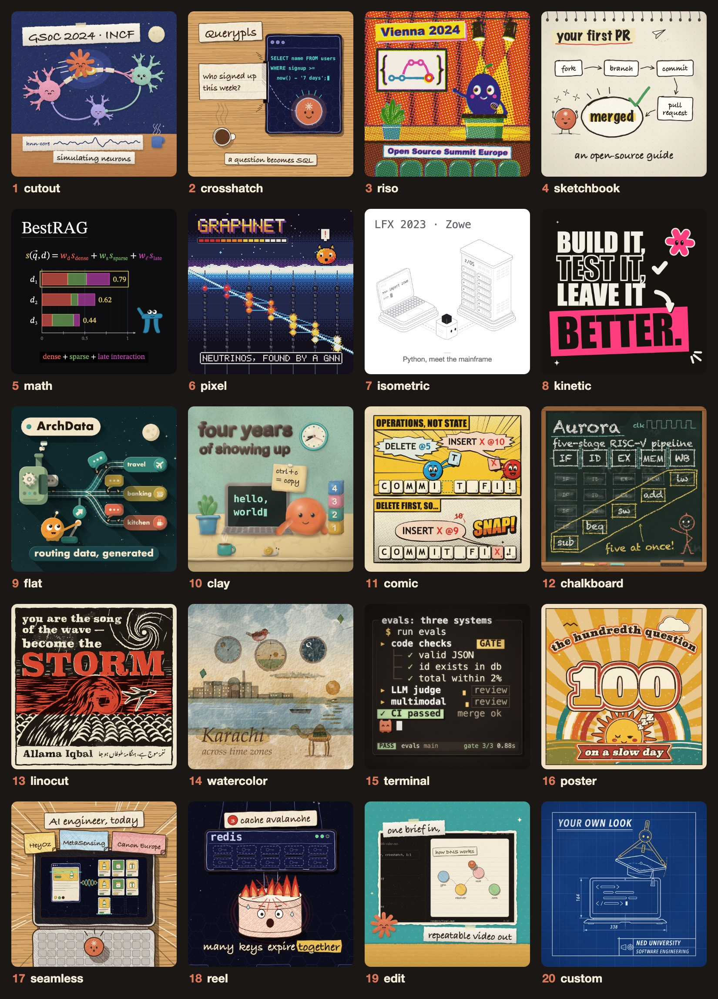

<div align="center">

# animate-pls

### Animated videos, written in code and narrated in your own voice, for free.

An agent skill for **Claude Code**, **Codex**, **Cursor**, **OpenCode** and any agent that reads skills.

[](LICENSE)
[](#install)
[](#install)
[](#designs)
[](#voices)
[](#sizes)

[**Install**](#install) · [**Make a video**](#make-a-video) · [**Designs**](#designs) · [**Voices**](#voices) · [**Edit your footage**](#edit) · [**Tools**](#tools)

<br>



<sub>Every tile is a frame drawn by animate-pls itself, and each one tells part of <a href="https://samadpls.com">samadpls</a>' story.</sub>

</div>

<br>

You describe the video. Your agent writes it as a single `<canvas>` page: every frame is drawn in code and every note of the music is synthesized. The tools then render it to MP4 with a headless browser and ffmpeg.

> [!NOTE]
> **No AI video model, no stock footage, no subscription.** Everything runs on your machine, and the same piece renders the same frames every time.

## Highlights

| | |
|---|---|
| **20 designs** | 16 styles, from cutout and clay to linocut and terminal, plus seamless one-take videos, reels, edits of your own footage and a custom look made from your references. |
| **Your voice, free** | Record 15–30 seconds of yourself. [VoxCPM2](https://github.com/OpenBMB/VoxCPM) clones it on your machine and reads every line in your voice. |
| **Edit your own footage** | Turn a screen recording or product demo into a polished video: framed, zoomed on every click, captioned, dead air cut. |
| **Reels that read on phones** | Word-by-word captions that stay clear of the TikTok, Reels and Shorts buttons, a hook in the first second, a cover image. |
| **Every size from one piece** | 9:16, 1:1, 4:5 and 16:9, each laid out for its shape rather than cropped. |
| **"Done" is measured** | Cuts on the beat, the story's loudness arc, clipped or hidden text, narration pace and loudness for phones. |

<a id="install"></a>

## Install

**You need** [Node 18+](https://nodejs.org), [ffmpeg](https://ffmpeg.org/download.html) on your PATH, and Playwright's Chromium:

```bash
npm i -g playwright && npx playwright install chromium
```

The quickest way: paste `https://github.com/samadpls/animate-pls` into your agent and ask it to install the skill. Or use your agent's own command:

| Agent | Install |
|---|---|
| **Claude Code** | `/plugin marketplace add samadpls/animate-pls` then `/plugin install animate-pls@animate-pls` |
| **Codex** | `codex plugin marketplace add samadpls/animate-pls` then `codex plugin add animate-pls@animate-pls` |
| **GitHub Copilot CLI** | `copilot plugin install samadpls/animate-pls:plugins/animate-pls` |
| **Gemini CLI** | `gemini skills install https://github.com/samadpls/animate-pls.git --path plugins/animate-pls/skills` |
| **Cursor, OpenCode and others** | `npx skills add samadpls/animate-pls -g` (the installer asks which agents; it needs Node 22.20+) |

<details>
<summary><b>By hand</b></summary>

<br>

Clone the repo and link the skill folder into your agent's skills directory:

```bash
git clone https://github.com/samadpls/animate-pls
ln -s "$PWD/animate-pls/plugins/animate-pls/skills/animate-pls" ~/.agents/skills/animate-pls
```

For OpenCode you can also list the folder in `opencode.json`: `{ "skills": { "paths": ["~/animate-pls/plugins/animate-pls/skills"] } }`.

</details>

<details>
<summary><b>The voice (once, optional)</b></summary>

<br>

Your agent runs this the first time you ask for a narrated video. It installs VoxCPM2 and faster-whisper into `~/.animate-pls/venv` and downloads about 5 GB of models once.

```bash
node <skill folder>/tools/voice-setup.mjs           # --check shows what is installed and which device it uses
```

It works best with [uv](https://docs.astral.sh/uv/getting-started/installation/), which picks the right PyTorch for your machine. Without uv it uses a Python 3.10–3.12 on your PATH.

</details>

<a id="make-a-video"></a>

## Make a video

Ask your agent in plain words, and name a design in one word:

```
/animate-pls a 45-second explainer of how DNS works, crosshatch, 1:1, in my voice
/animate-pls a 20-second reel about our launch, kinetic, 9:16
/animate-pls turn demo.mp4 into a product video, edit, 16:9 and 9:16
/animate-pls a 60s history of the bicycle, cutout, vertical, music only
```

In Codex or another agent, start with *"use the animate-pls skill to ..."*. Add **quick** to skip the waiting: one question round, one check-in, then the video. Quick mode still runs every quality check.

The full flow asks you to approve three cheap things before it spends time animating:

| Step | What you see | What you decide |
|:---:|---|---|
| **1 · Story** | The story format it picked and a numbered beat table, with facts checked on the web | Approve, or change beats |
| **2 · Look** | 2–4 full-size frames in the design | Thumbs up per frame |
| **3 · Storyboard** | Every beat as a key frame, with its sound and transition | Thumbs up or down by panel |
| **4 · Build** | The rendered video and the measured checks | Notes for a revision |

Videos are saved in your project under `pieces/<name>/renders/`.

<a id="designs"></a>

## Designs

Say the name and the agent knows what you mean.

| Name | The look | Good for |
|---|---|---|
| **cutout** | torn paper, drop shadows, crayon, characters with faces | histories, stories |
| **crosshatch** | sketchy ink that boils, hatching, warm paper | tool and code explainers |
| **riso** | a three-ink risograph print, halftone, misregistration | editorial, events |
| **sketchbook** | graphite and one accent colour, hand lettering | soft explainers, guides |
| **math** | a black stage, axes and graphs, colour-coded variables | anything with equations |
| **pixel** | low-resolution art, upscaled crisp | computing history, games |
| **isometric** | product line art, hairlines, one dark accent | products, infrastructure |
| **kinetic** | huge condensed type, one pop colour, stickers | reels, launch posts |
| **flat** | flat vector with long shadows, round characters | science and process explainers |
| **clay** | plasticine stop motion, fingerprints and all | warm personal stories |
| **comic** | brush ink, Ben-Day dots, balloons and sound effects | funny explainers |
| **chalkboard** | chalk on slate, written stroke by stroke | lessons, diagrams |
| **linocut** | a two-block relief print, carved gouges | quotes, bold statements |
| **watercolor** | loose washes, a sepia pen line, paper grain | places, gentle stories |
| **terminal** | a warm developer terminal, typed commands | dev tools, CLIs |
| **poster** | a 70s screenprint, sunbursts, echoed type | announcements, slogans |
| **seamless** | one continuous shot, no cuts (F9, one take) | product and feature films |
| **reel** | a hook, word captions, 9:16 first (F10) | Shorts, Reels, TikTok |
| **edit** | your own screen recording, framed and zoomed | product demos |
| **custom** | a new look matched from your videos, stills or web page | your brand |

Want real 3D? animate-pls has no 3D style. The skill guides you to write the scene with [three.js](https://threejs.org) (with [threejs-skills](https://github.com/CloudAI-X/threejs-skills) for your agent), record it with `tools/record.mjs` and finish it as an **edit**.

<a id="edit"></a>

## Edit your own footage

Bring a screen recording or a demo video you own, or let the agent record your web app from a short script of clicks and typing:

```bash
node tools/footage.mjs pieces/demo app demo.mp4 --cut auto      # import, cut dead air, suggest zooms
node tools/record.mjs pieces/demo app steps.json                # or record your own web app, frame by frame
```

The video comes back framed in the design you picked, with eased zooms on every click, a clean cursor, captions, title and end cards, and personal data blurred where you ask. See [edit.md](plugins/animate-pls/skills/animate-pls/edit.md).

<a id="voices"></a>

## Voices

| Voice | Cost | How it works |
|---|:---:|---|
| **Your own voice** *(default)* | Free | Drop 15–30 s of yourself talking into the piece. VoxCPM2 reads every line in your voice. |
| **A designed voice** | Free | Describe it in a few words, for example *"(a warm, calm narrator, unhurried)"*. |
| **ElevenLabs** | Your plan | You get the script as paste-ready text and send back the MP3; it is cut into lines in the silences between them. |
| **You read it** | Free | Record the whole script in one go; it is split into lines the same way. |
| **Music only** | Free | Captions and tags carry the story. |

> [!IMPORTANT]
> Only clone your own voice, or a voice whose owner has agreed to it.

<a id="sizes"></a>

## Sizes

| Size | Pixels | Best for |
|:---:|:---:|---|
| **9:16** | 1080 × 1920 | Shorts, Reels, TikTok |
| **1:1** | 1080 × 1080 | LinkedIn, X and other feeds |
| **4:5** | 1080 × 1350 | Instagram and LinkedIn feed |
| **16:9** | 1920 × 1080 | YouTube, talks, b-roll |

One piece renders to several sizes, each laid out for its shape (`--formats 9:16,1:1,16:9`).

<a id="tools"></a>

## Drive the tools yourself

```bash
SKILL=~/.claude/skills/animate-pls                                # or wherever your agent installed it

node $SKILL/tools/build.mjs pieces/my-piece                       # src/ + kit + style -> one index.html
node $SKILL/tools/tile.mjs pieces/my-piece tile.png 24 48 96      # test frames and a determinism check
node $SKILL/tools/export.mjs pieces/my-piece --share --formats 1:1,9:16
node $SKILL/tools/review.mjs pieces/my-piece                      # contact sheets and the measured checks
node $SKILL/tools/cover.mjs pieces/my-piece --gif 360             # a reel's cover, .srt/.vtt captions and a GIF

node $SKILL/tools/vox.mjs pieces/my-piece --ref me.m4a --audition # try voice settings on the first line
node $SKILL/tools/voice.mjs pieces/my-piece                       # word times and voice.wav

node $SKILL/tools/selftest.mjs                                    # the whole test suite on your machine
```

Open any built `index.html` in a browser to preview it: click to hear the music, and add `?t=12.5` to the URL to freeze a frame.

## Status

| | macOS | Linux | Windows |
|---|:---:|:---:|:---:|
| Build, export, review, edit | works | works | not tested yet |
| Voice (VoxCPM2, word timing) | works on Apple Silicon | works on CPU | not tested yet |

Linux was tested in a clean Ubuntu container. If you are on Windows, run `node tools/selftest.mjs` and tell us what it prints in an [issue](https://github.com/samadpls/animate-pls/issues).

## License

[MIT](LICENSE). See [credits](docs/CREDITS.md) and the [resources](docs/RESOURCES.md) this release learned from.

## Star history

<a href="https://www.star-history.com/#samadpls/animate-pls&Date">
  
</a>

<div align="center">
<br>
<sub>Made by <a href="https://samadpls.com">samadpls.com</a></sub>
</div>
