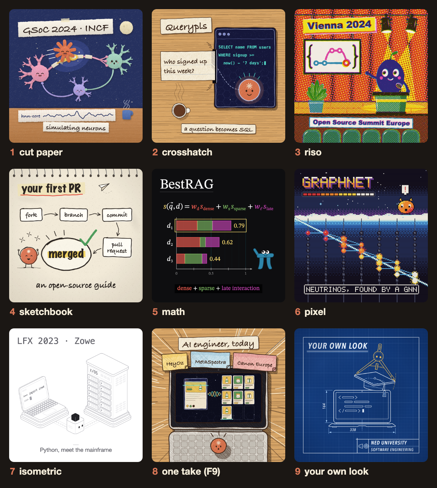
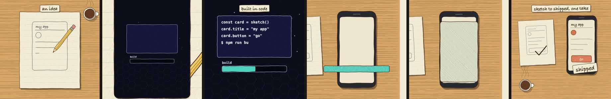

<div align="center">

# animate-pls

### Animated explainer videos, written in code and narrated in your own voice, for free.

An agent skill for **Claude Code**, **Codex** and any agent that reads skills.

[](LICENSE)
[](#claude-code)
[](#codex)
[](#voices)
[](#sizes)

[**Install**](#install) · [**Make a video**](#make-a-video) · [**Voices**](#voices) · [**Formats**](#story-formats) · [**Tools**](#tools) · [**Credits**](docs/CREDITS.md)

<br>



<sub>Every tile is a frame drawn by animate-pls itself: the seven styles, the one-take format, and a blueprint look made for this page. Each tells part of <a href="https://github.com/samadpls">samadpls</a>' story.</sub>

</div>

<br>

You describe the video. Your agent writes it as a single `<canvas>` page: every frame is drawn in code and every note of the score is synthesized. The tools then render it to MP4 with a headless browser and ffmpeg.

> [!NOTE]
> **No AI video model, no stock footage, no subscription.** The same piece renders the same frames on every machine, every time.

## Highlights

| | |
|---|---|
| **Your voice, free** | Record 15–30 seconds of yourself. [VoxCPM2](https://github.com/OpenBMB/VoxCPM) clones it on your machine and reads every line in your voice, rhythm and accent. |
| **Picture follows the voice** | Every word is timed locally. Cuts land after sentence ends, and a re-take re-times the whole video. |
| **One-take format** | No cuts, no slides: the camera pushes through one object into the next scene, or an object turns into its counterpart. |
| **Seven styles + yours** | Cut paper, crosshatch ink, riso print, sketchbook, math, pixel art and isometric, or a new look matched from your references. |
| **Every size from one piece** | 9:16, 1:1, 4:5 and 16:9, each laid out for its shape rather than cropped. |
| **"Done" is measured** | Cuts on the beat, the story's loudness arc, clipped or overlapping text, narration pace, and loudness for phones. |

<a id="install"></a>

## Install

**You need:** [Node 18+](https://nodejs.org), [ffmpeg](https://ffmpeg.org/download.html) on your PATH, and Playwright's Chromium:

```bash
npm i -g playwright && npx playwright install chromium
```

<a id="claude-code"></a>
<details open>
<summary><b>Claude Code</b></summary>

<br>

Paste into Claude Code:

```
/plugin marketplace add samadpls/animate-pls
/plugin install animate-pls@animate-pls
```

</details>

<a id="codex"></a>
<details>
<summary><b>Codex</b></summary>

<br>

Run in your terminal, then restart Codex:

```bash
npx skills add samadpls/animate-pls -a codex -g
```

</details>

<details>
<summary><b>Cursor, OpenCode, Gemini CLI and other agents</b></summary>

<br>

```bash
npx skills add samadpls/animate-pls -g
```

The [skills CLI](https://github.com/vercel-labs/skills) asks which agents to install it for.

</details>

<details>
<summary><b>By hand</b></summary>

<br>

Clone the repo and link the skill folder into your agent's skills directory:

```bash
git clone https://github.com/samadpls/animate-pls
ln -s "$PWD/animate-pls/plugins/animate-pls/skills/animate-pls" ~/.agents/skills/animate-pls
```

</details>

<details>
<summary><b>The voice (once, optional)</b></summary>

<br>

Your agent runs this the first time you ask for a narrated video, or you can run it yourself. It installs VoxCPM2 and faster-whisper into `~/.animate-pls/venv` and downloads about 5 GB of models once.

```bash
node <skill folder>/tools/voice-setup.mjs           # --check shows what's installed and which GPU it will use
```

It works best with [uv](https://docs.astral.sh/uv/getting-started/installation/), which picks the right PyTorch for your machine (CUDA, Apple Metal or CPU). Without uv it uses a Python 3.10–3.12 on your PATH.

</details>

<a id="make-a-video"></a>

## Make a video

Ask your agent in plain words:

```
/animate-pls a 45-second narrated explainer of how DNS works, crosshatch, 1:1, in my voice
/animate-pls a 30s one-take launch film for my app, isometric, 16:9 and 9:16
/animate-pls a 60s history of the bicycle, cut paper, vertical, music only
```

> [!TIP]
> In Codex or another agent, start with *"use the animate-pls skill to …"*. In Claude Code the plugin may list it as `/animate-pls:animate-pls`. Asking in plain words works too.

Before it spends any time animating, you approve three cheap things:

| Step | What you see | What you decide |
|:---:|---|---|
| **0 · Intake** | A few questions: subject, sizes, voice, look | Your answers, a style, or your references |
| **1 · Story** | The story format it picked and a numbered beat table, with facts web-checked | Approve, or change beats |
| **2 · Look** | 2–4 full-size style frames | Thumbs up per frame |
| **3 · Storyboard** | Every beat as a key frame, with its sound and transition | Thumbs up or down by panel |
| **4 · Build** | The rendered video and the measured checks | Notes for a revision |

Videos are saved in your project under `pieces/<name>/renders/`.

<a id="voices"></a>

## Voices

| Voice | Cost | How it works |
|---|:---:|---|
| **Your own voice** *(default)* | Free | Drop 15–30 s of yourself talking into the piece. VoxCPM2 reads every line in your voice. |
| **A designed voice** | Free | Describe it in a few words, e.g. *"(a warm, calm narrator, unhurried)"*. |
| **ElevenLabs** | Your plan | You get the script as paste-ready Eleven v3 text and send back the MP3; it's cut into lines in the silences between them. |
| **You read it** | Free | Record the whole script in one go; it's split into lines the same way. |
| **Music only** | Free | Captions and tags carry the story. |

<details>
<summary><b>Your own voice, step by step</b></summary>

<br>

1. Record 15–30 s of yourself talking naturally, in your normal voice and accent. A phone voice memo in a quiet room is fine. Save it as `pieces/<name>/voice/me.m4a` (any format works).
2. The agent writes the script, then auditions the first line in six settings so you can pick the take that sounds most like you.
3. It reads every line in that voice, times every word, and the picture follows.

> [!IMPORTANT]
> Only clone your own voice, or a voice whose owner has agreed to it.

</details>

<a id="sizes"></a>

## Sizes

| Size | Pixels | Best for |
|:---:|:---:|---|
| **9:16** | 1080 × 1920 | Shorts, Reels, TikTok |
| **1:1** | 1080 × 1080 | LinkedIn and other feed posts |
| **4:5** | 1080 × 1350 | Instagram and LinkedIn feed |
| **16:9** | 1920 × 1080 | YouTube, talks, b-roll |

One piece renders to several sizes, each laid out for its shape (`--formats 9:16,1:1,16:9`).

<a id="story-formats"></a>

## Story formats

The agent picks the format from what drives your story; you can veto it at the story check.

| | Format | Shape | Status |
|:---:|---|---|:---:|
| F1 | Machine | One token travels through stations on one big sheet | studied |
| F2 | Chronology | Eras joined by shape morphs; a history | proven |
| F3 | Catalogue | A question answered by a list, cut on the beat | studied |
| F4 | Mission | Someone wants something; a helper solves it step by step | proven |
| F5 | Fixed-hero journey | The hero holds its spot while the world changes; narrated pieces | proven |
| F6 | Process loop | Finished result → blank → the real making steps → result | studied |
| F7 | Variation reel | One subject redrawn N ways, one per second | studied |
| F8 | Trailer | Claim cards proved by footage | sketch |
| **F9** | **One take** | **Every beat carried into the next, no cuts** | new |

<p align="center">
  
  <br>
  <sub><b>F9 · one take</b> (<a href="plugins/animate-pls/skills/animate-pls/templates/one-take/">templates/one-take</a>): a sketched card opens into the machine, the build bar becomes the phone's screen, and the camera pulls back to the sketch next to the real thing.</sub>
</p>

<a id="tools"></a>

## Drive the tools yourself

```bash
SKILL=~/.claude/skills/animate-pls                                # or wherever your agent installed it

node $SKILL/tools/build.mjs pieces/my-piece                       # src/ + kit + style -> one index.html
node $SKILL/tools/tile.mjs pieces/my-piece tile.png 24 48 96      # test frames + a determinism check

node $SKILL/tools/vox.mjs pieces/my-piece --ref me.m4a --audition # try voice settings on the first line
node $SKILL/tools/vox.mjs pieces/my-piece --ref me.m4a --cfg 1.6  # every line, in your voice
node $SKILL/tools/eleven-script.mjs pieces/my-piece               # or: paste-ready ElevenLabs text
node $SKILL/tools/split-take.mjs pieces/my-piece take.mp3         # one long take -> one take per line
node $SKILL/tools/voice.mjs pieces/my-piece                       # word times + voice.wav

node $SKILL/tools/export.mjs pieces/my-piece --share --formats 1:1,9:16
node $SKILL/tools/review.mjs pieces/my-piece                      # contact sheets + the measured checks
```

Open any built `index.html` in a browser to preview it: click to hear the score, and add `?t=12.5` to the URL to freeze a frame.

## Status

| | macOS | Linux | Windows |
|---|:---:|:---:|:---:|
| Build, tile, export, review | works | not yet | not yet |
| Voice (VoxCPM2 clone + design, split, timing) | works on Apple Silicon | not yet | not yet |

The one-take format is new: its template passes every check, but no full piece has used it yet. Reports and fixes are welcome.

## License

[MIT](LICENSE). Built on [animate](https://github.com/cth9191/animate) by cth9191; see [credits](docs/CREDITS.md).

<div align="center">
<br>
<sub>Made with ❤️ by <a href="https://samadpls.com">samadpls.com</a></sub>
</div>
