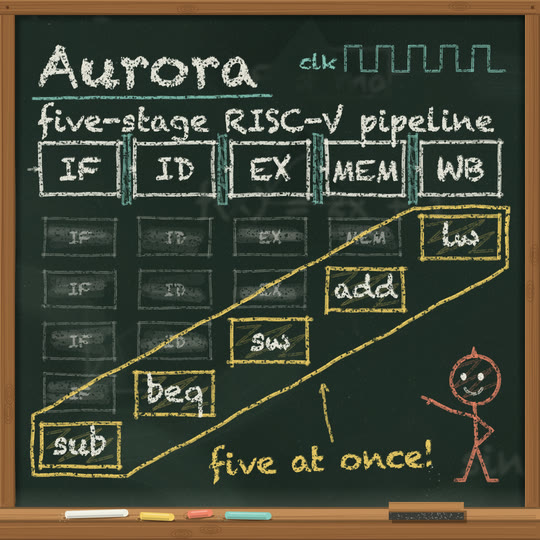

# Chalkboard

A classroom slate. A deep green-black board, never one flat colour: soft mottle, the ghosts of old lessons half wiped away, and the haze of eraser swirls. Around it sits a wooden frame with a chalk ledge holding sticks of chalk and a felt eraser. Everything on the board is chalk, drawn stroke by stroke: grainy, broken lines that boil a little on 2s, hand lettering, boxes, arrows, underlines and loops. Dust falls from the stick as it writes. A small coral chalk person with a round face lives on the board and points at the lesson. It belongs with the handmade styles: real texture and warm colours, with no glow and no gradient fields.

## Palette and meaning (`CHP` in kit.js)

| colour | hex | meaning |
|---|---|---|
| board | `#1f2c26` | the slate (`STYLE.paper`); with `const CH_SLATE = true` a warm charcoal `#2a2826` |
| boardD | `#16201b` (charcoal `#1e1c1a`) | a freshly wiped strip (behind captions) |
| white | `#f1eee2` | structure and lettering: boxes, arrows, titles, the hero's eyes and smile |
| yellow | `#f2cf66` | **what the story follows**: the thing that moves (an instruction in flight, the falling apple, the moon) and the emphasis on it (the loop around it, its note) |
| coral | `#f0866a` | **the hero, only the hero** |
| teal | `#8acdbf` | secondary: measures and labels, registers, the clock, underlines, a canopy |
| dust | `#e6e3d6` | dust in the air, eraser haze, the ghost of an erased mark |
| wood / woodD / woodL | `#93623a` / `#5e3a20` / `#c08c5a` | the frame and ledge; felt `#3b3a36` for the eraser |

No hue between 220° and 330° anywhere (no purple, violet or periwinkle). The only gradients are the slate's faint mottle and the frame's shadow on the board.

## Line and texture

- **A chalk stroke** (`chLine`) is a soft core at about 0.42 alpha plus 2-4 thin fibres offset across its width. Each fibre is broken by a seeded dash pattern, the dry-brush gaps of a stick dragged along the board. Edge crumbs fleck either side. The fibres' dashes are seeded per stroke (`key`); the stroke's wobble and the dash phase change every boil step, so held chalk stays alive. The default width is 6.5 px at 1080 (`CH_W`).
- **The pits:** all chalk is drawn inside `chalk(() => { ... })` on a scratch layer. One `destination-out` pass of a seeded pit tile (powder holes, pits, a few voids) is then anchored to the board's world coordinates. The pits stay put while the strokes boil over them, which is how chalk skips a slate's hollows. This is what makes any handwriting face read as chalk.
- **Lettering** (`chText`) is a real `fillText`, so the text check reads it. A second print at 0.28 alpha, offset by about 1.4 px, gives the powdery edge, and then the pits apply. It writes on left to right with `frac`. Faces: **Chalkduster** on macOS; **Ink Free** on Windows 10+ (Segoe Print on older Windows); **Comic Neue**, or the system's cursive default, on Linux. On Windows and Linux the face is a marker-like hand rather than a chalk font, and the double print and the pits supply the chalk texture. Every label is fit to a width (`maxW`) because these faces differ a lot in width (Chalkduster is the widest).
- **Fills** are zigzag scribbles that turn at the shape's edges (`chScribble`), at low pressure, never solid.
- **The board** (`chBoard`) is cached once per key at half resolution, since the slate is soft. It holds the mottle, 16 old lessons (equations and little diagrams) blurred and then mostly wiped, eraser swirls with the felt's drag lines inside them, and specks. A full-resolution speck tile sits over it.
- **The frame** (`chFrame`) is cached: wood strips with grain and knots, the frame's shadow on the slate, settled dust above the ledge, four sticks (white, yellow, coral, teal) and a felt eraser.

## Motion habits

- **On 2s** (`ones: false`). Things are drawn on, not moved: a mark appears stroke by stroke (`frac`), and a thing that moves is erased and redrawn in its new place. A ghost of its dust (`chGhost`) is left behind.
- **Dust:** every write-on sheds falling specks along its path (`chDust(P, t0, d)`). The specks are stateless, each born at a seeded time and place. Motes drift through the air in `post`.
- **The hero** bobs and blinks. It points with a straight arm and a finger at a world point (`point`), and talks (its mouth opens on alternate boil steps), stands or sits.
- **Morphs:** the eraser wipes the board around the bridge object, leaving a ring of haze and drag marks (`window`). On the wiped board the object becomes a chalk scribble (`blob`), and the new lesson opens out of its counterpart. Tags and captions are erased right to left as the bridge starts.
- **Camera:** still, or a slow push on the bridge object (z of 1.12 or less, so text stays clear of the phone UI).

## Kit API (`kit.js`, on top of `kit/core.js`)

- Layer: `chalk(fn, { pits, alpha })`. Chalk functions called outside one open their own; that is fine for one-offs and slower in bulk.
- Strokes and marks (all take `{ c, w, press, frac, key, fibres, amt }` and write on with `frac`): `chLine(P, o)`, `chBox(x, y, w, h, o)` (four overshooting strokes, returns the tip), `chArrow(P, { head })`, `chLoop(cx, cy, rx, ry, rot, o)`, `chScribble(P, { gap, a, inset })`, `chStar(x, y, r)`.
- Lettering: `chText(str, x, y, size, { c, align, maxW, frac, rot, press })` returns `{ w, size, tip }`. Also `chFit(str, size, maxW)` and `chTextW(str, size)`.
- Dust and erasing: `chDust(P | [x, y], t0, d, { n, life, g })`, `chGhost(x, y, w, h, key)`, `chWiped(x, y, w, h, key)`, `chEraseRim(P, key)`, `chMotes(n)`.
- Board: `chBoard(c, key)` (call first, under the camera), `chFrame({ side, ledge, sticks, eraser })` (call last), `chInside()`.
- Hero: `chHero(x, y, s, { key, mood: 'smile' | 'wow' | 'talk', point: [x, y], look, wave, sit, c })`. (x, y) is the head's centre and s its radius; the figure is about 5.2 s tall. It sets `SPARK_AT`.
- Captions: `chTag(str)` (yellow, top left, teal underline) and `chCaption(str, { at, y, size })` (white on a wiped strip), both through `DEFER`.
- `STYLE`: `paper` (the board), `backdrop` (the wiped board and its frame; a piece can pass frame options in `CH_FRAMEOPT`), `window` (the eraser's hole), `blob` (a chalk scribble shape), `hero`, `heroColor` (coral), `heroPts` (the head), `post` (motes), `ones: false`.

## Frame checklist (on top of grammar/FRAME.md)

1. **The board is a used slate:** mottle, faint ghost lessons and eraser haze, never a flat fill. The frame and ledge show at least on the opening frame.
2. **Every mark is chalk:** grainy and broken, pitted, and boiling on 2s. Nothing solid, nothing smooth, no gradients, no glow.
3. **Colour means one thing:** white builds the lesson, yellow is the thing in motion and its emphasis, coral is the hero alone, and teal is for measures and labels.
4. **It is drawn, not pasted:** each new thing writes on stroke by stroke and sheds dust. Moving things are erased and redrawn, and leave a ghost.
5. **One teacher's move per beat:** a loop round the answer, an underline, an arrow to it, a note beside it ("five at once!").
6. **Lettering is at least 60 px at 1080** for anything that must read. Fit it to a width, and check digits in Chalkduster: its 5 reads as an S, so spell numbers out in short notes.
7. **The hero is on the board,** in coral chalk, and acts: it points at the thing, sits on it, or reacts.
8. **Diagrams are lecture diagrams:** boxes, arrows, axes, loops. Text goes inside boxes or on the board itself, never in UI chrome.
9. **9:16:** captions and tags sit inside x 120-888 and y 288-1248, and left of x 780 below y 840. A camera push moves labels outward, so check text during the push.

## Do / don't

- **Do** draw the board first and the frame last, with all chalk in between, inside one `chalk()` block per scene. Each block costs a full-frame composite.
- **Do** give every mark its own `key`, so its fibres and pits stay its own as it boils.
- **Do** spell out digits that matter in Chalkduster ("five", not "5").
- **Don't** fade chalk with `globalAlpha` to hide it. Lower `press` to make it fainter, or erase it (skip it and leave a `chGhost`).
- **Don't** use a UI sans for lettering. The hand faces fall back to cursive, and the pits carry the chalk look.
- **Don't** put a solid or a soft glow behind text. Use a wiped strip (`chWiped`).

## Performance (measured, Apple M3 Pro, headless Chromium)

| piece | warm frame | first frame (the board, frame and pit caches built) |
|---|---|---|
| demo 9:16, 1080x1920 | 47-63 ms | ~260 ms; the first frame of a new board key also ~180-210 ms |
| demo 1:1 / 16:9 | ~8-110 ms / ~11-220 ms (cache-building frames included) | ~150 / ~260 ms |
| tile 1:1, 1080x1080 | 19-42 ms | ~170 ms |

Most of a warm frame is the full-frame chalk composite (clear, pit pass, draw) and the cached board blit. Every `chBoard` key builds its own texture once (blur filters, ~150 ms), so keep to one or two keys per piece.

## Credits

The chalk idea is a stroke laid at partial alpha with dust holes punched out of it afterwards. It comes from **0xmmo/chalkboard** (formerly mmoustafa/Chalkboard, `js/chalk.js`) by Mohamed Moustafa: https://github.com/0xmmo/chalkboard. Its README declares MIT ("Copyright (C) 2012 Mohamed Moustafa"); the repo has no licence file. Only the idea was used and no code was copied. Here, the holes are a seeded tile anchored to the board and punched once per layer, not random per segment; the fibres, dry-brush dashes, scribbles, dust physics, slate texture, frame, hero and STYLE hooks are new. The palette is our own.

## Not matched / open

- Chalk lettering depends on the OS face. Only macOS has a true chalk font (Chalkduster). Windows and Linux get a handwriting face made chalky by the pits, which has not been looked at on those systems yet.
- Smudging with a finger, shading by rubbing the side of the stick, and erasing with visible felt motion are not in the kit.
- Chalk is opaque light on dark: overlapping marks lighten each other and never darken, so very dense diagrams turn to white mush. Keep marks spaced.

## Proven on

This demo (`demo/`: 6 s, 9:16 with 1:1 and 16:9, 120 BPM at 24 fps). A physics lesson: an apple falls from a chalk tree with its positions ghosted at equal times, and the hero points. The apple becomes the moon, which falls around the Earth while the hero sits on it. The tile is deterministic and the review passes. Also the gallery tile `docs/gallery/17-chalkboard` ("Aurora · a 5-stage RISC-V pipeline").
