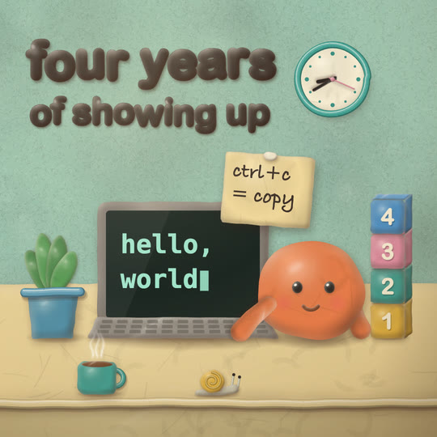

# Clay

Plasticine stop motion on a tabletop set. Every object is a soft, rounded piece of modelling clay lit by one warm key light from the top left: a lit top, a shaded underside, a waxy sheen with a small sharp glint, fine pigment speckle, tool marks and faint fingerprints, a soft cast shadow, and a contact shadow wherever it rests on the set. Things the animator touches (the hero, a lump being kneaded, a block being dropped) boil: their lumpy edges and crumbs shift on every step on 2s. The set (felt wall, clay table, wall clock, window) holds still. Lettering is rolled clay. It belongs with the handmade styles (cut paper, crosshatch, riso, sketchbook): warm natural colours, real texture, no gradients standing in for light, no glow.

## Palette and meaning (`CLAY` in kit.js)

| colour | hex | meaning |
|---|---|---|
| hero coral | `#ee7a45` | **the hero, only the hero** (the round lump with dot eyes, its arms) |
| felt sage | `#9cc2ad` | the day wall (felt) |
| night felt | `#1f3550` | the night sky / a dark wall (a deep blue-green, kept below hue 220) |
| butter | `#f1d79a` | a light clay table (tile) |
| walnut | `#a8714a` | a dark clay table (demo); light pieces pop on it |
| card | `#d4bd9b` | `STYLE.paper`: the kraft card a morph happens on |
| cream / moon | `#f7ecd2` / `#f6e3b0` | clay letters on dark grounds, plaques, the lump, the moon |
| cocoa | `#3a2d27` | clay letters on light grounds, printed text: a warm dark clay, the strongest contrast on sage felt that doesn't compete with the coral hero |
| ink | `#2a2422` | dot eyes, clock hands (never pure black) |
| stone / stoneD | `#8c8279` / `#5e564f` | rigid things: a laptop, a machine (warm grey clay) |
| screen | `#1b2420` | a lit screen: green-black, mint `#9fe3c9` text |
| mustard, teal, rose, sky blue | `#e8b440`, `#3f9d8f`, `#e58ea2`, `#4b8fc6` | props (blocks, mugs, pots, houses, shells) |
| leaf | `#5d9e58` | plants, hills |

No purple, violet or periwinkle: no colour in the kit, the demo or the tile has a hue between 220° and 330°. No gradient fields. The only gradients are the clay's own shading, contact shadows, blush and the studio vignette.

## Line and texture

- **No outlines.** A piece is a silhouette turned into clay (`clayPiece`): base colour, then speckle (about area/300 crumbs, half darker, half lighter), tool marks (area/8000 smears) and fingerprints (area/11000 groups of six concentric arcs; prints and marks grow with the piece's size so they show on a phone), a volume gradient from the light, a bevel from the blurred inverse silhouette (dark on the edges away from the light, light on those facing it, never more than 14% of the piece's smaller side), a broad sheen plus a small sharper glint, then trimmed to the silhouette.
- **Shadows:** each piece casts a soft blurred copy of itself down-right (offset about 6, 11 px); anything resting on the set also gets a squashed radial contact shadow (`clayContact`).
- **Edges:** outlines go through `clayLumpy` (Catmull-Rom through control points pushed along the normals by a seeded amount). Subdivide straight edges first (`clayRR(..., step)`) where corners matter, or the lumps round a block into a pillow.
- **Ropes and coils** (`clayRope`): layered round strokes (shadow, dark edge, body offset toward the light, a lighter core, a highlight line) with crumbs along them. Cheap, so they suit moving or huge outlines: the morph window's ring, cables, handles, trims, a snail's shell.
- **Lettering:** a heavy rounded system font, filled and stroked with round joins so every terminal rolls, each letter a slightly crooked piece with its own bevel, sheen and cast shadow. The colour is a real `fillText` (the text check reads it); the clay is laid over it.
- **The set:** felt (seeded fibres and soft mottling over a flat colour, one cached texture), clay tables with a rolled front trim, a warm studio vignette in `post` (cached, plus a 0-2% exposure flicker per drawing, keyed on B).
- **Screens and paper stay flat:** a laptop screen is a flat card with one hard reflection band; text on a note is pressed onto a flat clay slab.

## Motion habits

- **On 2s** (`ones: false`), the stop-motion norm: every drawing is held two frames. On 3s reads as choppy at 24 fps for this much character motion and fights the renderer's 2s clock, so the kit stays on 2s.
- **Boil:** characters and handled props cycle three drawings (`clayV()` = B % 3) of their lumps, crumbs and prints. Pass it as `variant` and in the lump seed (`clayLumpy(P, key + clayV(), amt)`). The set never boils.
- **Stop-motion moves:** a drop falls in three or four drawings, then squashes (1.16, 0.8) for one, stretches back (0.96, 1.06), settles. Pops go 0.4, 1.18, 0.96, 1 (`clayPop`). Repeated actions alternate between two poses on 2s (typing, patting, waving).
- **Small life everywhere:** the hero breathes and blinks, a clock's second hand ticks, steam drifts, plants sway, a snail creeps, a window cloud passes, stars twinkle between three sizes.
- **Morphs:** the old world closes through a ring of rolled clay in the bridge object's colour; on the kraft card the object squashes into its counterpart as a boiling lump (`blob`); the new world opens through the counterpart's ring.

## Kit API (`kit.js`, on top of `kit/core.js`)

- Colour: `CLAY`, `clayShade(c, ±pct)`, `clayRgba(c, a)`, `clayRGB(c)` (all take `#hex` or `rgb()`).
- Outlines (local coordinates): `clayEll`, `clayRR(x, y, w, h, r, step)`, `clayCapsule(line, r | [r0, r1])`, `clayBean(cx, cy, w, h, key)`, `clayLumpy(P, key, amt)`, `clayCatmull`, `clayWob(P, closed, amt, key, v)`.
- Pieces: `clayPiece(key, shape, color, { bevel, soft, shine, speckle, marks, prints, volume, light, shadow, shadowBlur, shadowOffset, variant, base, hi, lo, cache, res })`. `shape` is a point list, or `{ box, fn(g), id }` for text, several blobs or holes. `clayContact(x, y, rx, ry, a)`, `clayRope(P, r, color, { closed, key, v, amt, shadow, speck })`.
- Letters and captions: `clayLetters(str, x, y, size, color, { pop, gap, by: 'word' | 'letter', align, tilt, roll })`; `clayTag(str, { t, size, color })` (top left, letter by letter); `clayCaption(str, { x, y, t, plaque, color })` (a cream plaque). Both go through `DEFER`.
- Set: `clayFelt(c)`, `clayTable(y0, depth, color, { trim })`, `clayWindow(x, y, w, h, { sky, moon })`, `clayClock(x, y, r, { h, m, at })`, `clayLight()` (the post pass).
- Hero: `clayHero(x, y, r, { key, mood: 'smile' | 'focus' | 'wow' | 'blink', look: [dx, dy], arms: [{ side, a, len, front }], squash, hop, boil })`. A round coral lump sitting on its flat underside, dot eyes with a glint, cheeks, a pressed mouth, sausage arms. Sets `SPARK_AT`.
- Props (each rests at (x, y) = the middle of its base, in local coordinates): `clayLaptop(x, y, w, { screen(x, y, w, h) })`, `clayMug(x, y, r, color)` + `claySteam`, `clayBlock(x, y, s, label, color)`, `clayPlant(x, y, s, { pot })`, `clayNote(x, y, w, h, lines, { font, size, rot })`, `claySnail(x, y, s)`.
- Cache: `claySprite(id, box, res, draw)` over `CLAY_CACHE` (see Performance), `clayV(n)`.
- `STYLE`: `paper` (kraft card), `backdrop` (felt), `window` (a clay ring with a cast shadow into the hole), `blob` (a boiling clay lump, uncached), `hero`, `heroColor`, `heroPts`, `post` (studio light), `ones: false`.

## Frame checklist (on top of grammar/FRAME.md)

1. **Every object is clay:** bevel, speckle, a cast shadow; anything resting on the set has a contact shadow. No flat vector shapes, no outlines.
2. **One light, top left:** every highlight sits up-left and every shadow falls down-right, including the ropes'.
3. **What the animator touches boils; the set does not.** Step through frames: the hero's lumps change every 2 frames, the wall and the table never do.
4. **Fingerprints or tool marks read on the big pieces at phone size** (the hero, a lump, the table). Without them it looks like a vinyl toy or a 3D render.
5. **Coral is the hero's alone.** No coral props, no coral text.
6. **Lettering is rolled clay** (`clayLetters`), at least 60 px at 1080, cocoa on light felt or cream on dark; captions are short lines pressed on a plaque.
7. **Screens and paper stay flat and printed;** nothing glows.
8. **Small pieces aren't washed out:** keep `bevel` modest on anything under ~80 px (the kit caps it at 14% anyway).
9. **Warm and natural:** felt, card or wood-coloured grounds; no hue between 220° and 330° (purple, violet, periwinkle), no gradient fields, no glass.
10. **Every move is stop motion:** stepped on 2s, with squash on contact; nothing eases smoothly across many frames.

## Do / don't

- **Do** build outlines in local coordinates and move them with `ctx.translate` / `rotate` / `scale`: a moved, rotated or squashed piece reuses its cached sprite. An outline built at absolute coordinates that change every frame bakes a new sprite every frame (and churns the cache).
- **Do** split a bent limb into pieces (a capsule along a polyline is fine; don't bend one piece into a U).
- **Do** give thin rigid things (a laptop lid, a note) a small bevel; a big bevel makes them cushions.
- **Don't** pass `variant: clayV()` to the set; a boiling wall is noise.
- **Don't** fade a piece with `globalAlpha` to hide it: its cast shadow is a separate layer and shows through the half-faded clay. Skip the piece instead.
- **Don't** use a system UI font (Segoe, SF) for display. The letter stack is Arial Rounded MT Bold, then Cooper Black, then Arial Black (stroked round, so any of them rolls), then DejaVu Sans.

## Performance (measured)

Headless Chromium from Playwright 1.64.1 on an Apple M3 Pro, with a GPU sync after every frame (`getImageData(0, 0, 1, 1)`):

| piece | cold first frame | sequential pass (one export worker) | warm frames | frames that only blit | whole pipeline uncached |
|---|---|---|---|---|---|
| demo 9:16, 1080x1920 | 328 ms | 32 ms avg | 28 ms avg, 47 max (morph frames 28 avg) | 26 ms avg, 36 max | 385 ms avg, 471 max |
| demo 16:9, 1920x1080 | 349 ms | 30 ms avg | 23 ms avg, 30 max | 24 ms | 387 ms |
| demo 1:1, 1080x1080 | 204 ms | 20 ms avg | 15 ms avg, 19 max | 16 ms | 244 ms |
| tile 1:1, 1080x1080 | 222 ms | 24 ms avg | 19 ms avg, 25 max | 19 ms | 224 ms |

- **The cache is what makes it fast:** baking a piece (two scratch canvases, a handful of blurred draws, and its cast shadow) takes about 5 ms on average (a 9:16 frame's ~80 sprites baked from nothing: ~385 ms); a frame whose sprites are all cached costs 16-26 ms. `CLAY_CACHE` is an LRU (a `Map` in use order) capped at 600 sprites and 24 Mpx (~96 MB) per page. An id is `key | variant | resolution step | colour | a hash of the outline's points (to 1/4 px) | the look options`, so a changed outline, colour or option never draws a stale sprite. A whole 6 s demo uses ~400 distinct sprites (~26 Mpx). Sprites are baked at the next resolution step above the current scale (0.35 to 2.8), so a camera push re-bakes once per step.
- **Uncached by design:** the morph `blob` (`cache: false`; its outline changes every frame) and ropes (plain strokes). A full set baked from nothing costs 200-500 ms, which happens once per worker at the first frame and once per new scene.
- **The post pass** blits a quarter-resolution vignette with plain bilinear smoothing. `imageSmoothingQuality = 'high'` on that upscale cost ~35 ms a frame; don't.
- Determinism: sprites are pure functions of their id, so a cold page and a warm one draw identical pixels (`tile.mjs` renders every frame twice, in two orders, and compares). Blur output can differ between GPU and software raster, so stills aren't byte-identical across machines.

## Not matched / open

- Hands with fingers and Aardman-style eyes (big whites, lids) aren't in the kit; the hero is a lump with dot eyes and mitten arms.
- Clay letters come from a font, so a missing Arial Rounded MT Bold (Linux, Windows without Office) falls back to a heavier, less rolled face.
- Upstream marks its clay kit as "in testing" too; this one has carried this demo and one tile, no full piece yet.

## Credits

The clay shading pipeline (silhouette, speckle, tool marks, fingerprints, volume gradient, inverse-silhouette bevel capped at 14%, sheen, destination-in trim, cast shadow, contact shadow, lumpy Catmull-Rom outlines, capsules, beans, clay text as a silhouette, boiling on twos) is adapted from **illodev/drawn-by-code**, `styles/clay/clay.js` and the sprite cache in `engine/core.js`: https://github.com/illodev/drawn-by-code (MIT; its LICENSE excludes only fonts/, assets/sfx/ and rendered media, none of which were used; ported from commit 3c9c949). Changes: our seeded `RNG` instead of `Motion.rng`; system fonts instead of Shrikhand; texture sizes, print and mark scaling for a 1080 frame; a second sharper glint; text drawn as real `fillText` with the clay laid over it; a capped LRU cache keyed by the outline's hash, colour and options (upstream keys on name and scale only, in an unbounded map); ropes, the set, the hero, props and STYLE hooks are new. The palette is our own.

## Proven on

This demo (`demo/`: 6 s, 9:16 with 1:1 and 16:9, 120 BPM at 24 fps: the hero pats a lump into a ball on a walnut table; the ball becomes the moon, hung on a thread over a clay village at night; tile deterministic, review passes) and the gallery tile `docs/gallery/13-clay` ("Four years of showing up").
