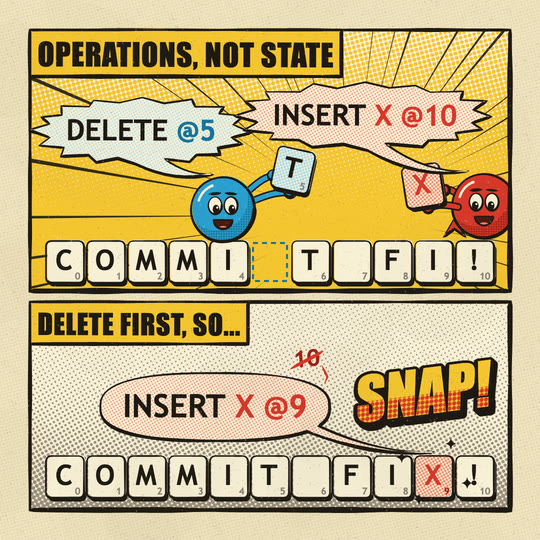

# Comic

A printed comic page. Every outline is a bold brush stroke that swells and tapers, heavier on the side away from the light. The colours are three flat process inks (warm yellow, red, cyan) on aged newsprint. Ben-Day dots do the tints and the shading, and the colour plate prints a hair off the ink. Each era is a panel with a brush-ruled border and a paper gutter. Speech balloons have curved tails and lettered caps, narrator boxes are yellow, SFX are condensed caps with an extruded drop shadow, and there are speed lines and action bursts. Limited animation on 2s.

## Palette (`CM` in kit.js; no hue between 220 and 330 degrees)

| name | hex | meaning |
|---|---|---|
| `paper` | `#efe2bf` | the newsprint page, the morph's blank sheet |
| `paperL` / `paperD` | `#f8efd6` / `#dccb9f` | unprinted paper inside panels, balloons and tiles / a paper shadow |
| `ink` | `#1e1814` | every outline, speed line, pupil and the lettering: a warm black, never pure black |
| `yellow` (`yellowL`, `yellowD`) | `#f5c531` (`#f9df8a`, `#d9a21c`) | narration and noise: narrator boxes, SFX faces, the dot ramps behind action |
| `red` (`redD`, `redL`) | `#d8372a` (`#9e2219`, `#ef8a6f`) | **the hero** and the hero's own things (its op, its tile). Never decoration |
| `cyan` (`cyanD`, `cyanL`) | `#2a9fd0` (`#17739a`, `#a3d8ec`) | the second character / the other side; sky dots |
| `orange`, `green` (`greenD`) | `#ec7b2c`, `#5ca349` (`#3c7a32`) | overprints (red + yellow, cyan + yellow) for props and buildings |
| `skin`, `mouth`, `tongue`, `grey` | `#f6d2a3`, `#4a1a12`, `#ef7d6b`, `#8a8178` | faces, small print (tile numbers) |

A colour shades with **dots of its darker tone** (or ink dots), never a gradient. Large grounds are dot ramps (`cmDotField`) on paper.

## Line and texture

- `cmRibbon` is the brush: a filled ribbon, not a stroke. Width varies with a seeded wobble. Closed outlines are 0.6× on the lit side (top-left) and 1.45× on the shadow side; open strokes taper to points. Outlines are about 5 px at 1080 for props, 0.085 r for characters, 8 px for panel rules and 10 px for the morph iris. Lines re-wobble a little every boil step.
- **Misregistration**: `cmShape` prints the colour plate `CM_REG` = [2.6, -1.8] px off the ink (plus ±0.5 px per boil step), so a sliver of paper shows on one side and colour creeps past the line on the other. Balloons, tiles and lettering stay on register.
- **Ben-Day dots**: `cmDots(colour, r, pitch, angle)` is a cached 5-dot pattern tile rotated by angle. Shading (`shade:` in `cmShape`) fills the part of a shape that is not covered by a copy of itself pulled toward the light, which gives a crescent of dots on the lower right.
- **Newsprint**: `STYLE.post` lays a cached full-frame texture over everything (fibres, warm specks, ink dropouts, a few faint blotches). The page itself (`cmPage`) is paper plus a faint 9 px dot screen.
- **Type** (local fonts only):
  - SFX and narrator boxes use `CM_SFX` = Bangers if the user has it installed, else **Impact** (Windows and macOS ship it), Haettenschweiler, Arial Narrow Bold, then **DejaVu Sans Condensed** or Liberation Sans Narrow (most Linux).
  - Balloons and tiles use `CM_LETTER` = **Trebuchet MS** bold (Windows and macOS), else **DejaVu Sans** bold or Liberation Sans (Linux).
  - Comic Sans is deliberately not in either stack. Write all lettering in caps. Balloons size themselves to `measureText`, so a wider fallback face grows the balloon instead of overflowing it.

## Motion habits

- On 2s (`ones: false`): every drawing is held two frames, and lines, speed lines and bursts re-draw each step (the limited-animation boil). Speed lines can be held longer with `hold`.
- Pose to pose: anticipation (squash), then the action, then a settle. Balloons and SFX **pop** (`popS`, back-eased), and SFX jitter a pixel per step.
- Action reads from motion marks, not motion blur: radial speed lines (`cmSpeed`), streaks behind movers (`cmStreaks`), emanata ticks for surprise (`cmEmanata`), a burst behind an impact.
- Things can break the panel border (a balloon flying across the gutter, an SFX over the rule). Draw them after `cmPanel`.
- **Morph**: the old era closes through an iris drawn as a panel (speed lines rush out of it, a paper gutter ring, a brush rule). The shape bursts into a jagged action star at mid-morph (`blob`: spikes peak at u = 0.5) with speed lines around it, then settles into the new shape. Bridge shapes of similar proportions (a clock face into the sun).

## Kit API (`kit.js`, on top of `kit/core.js`)

- Ink: `cmRibbon(P, { closed, w, key, amt, raw, frac, lit, heavy, taper, c })`, `cmLine(P, w, key, o)`, `cmPath(P)`.
- Print: `cmShape(P, { fill, shade, sr, sgap, sang, depth, tint, w, line, key, raw, mis })`, `cmDots(c, r, pitch, angle)` (pattern), `cmTint(P, c, r, pitch, angle)`, `cmDotField(key, x, y, w, h, c, pitch, angle, rFn(u, v))` (cached dot ramp), `cmBox(x, y, w, h)`.
- Page: `cmPage({ c, dots })`, `cmPanel(x, y, w, h, { bg, fn, w, key, gutter, P })` (contents clipped inside `fn`, rule drawn after), `cmNewsprintTex()`.
- Action: `cmSpeed(cx, cy, r0, r1, n, { w, a0, span, hold })`, `cmStreaks(x, y, ang, n, spread, { len, w })`, `cmBurstPts` / `cmBurst(cx, cy, rx, ry, { n, inner, fill, rot })`, `cmEmanata(x, y, r, n, { a0, span })`, `cmCloudPts` / `cmCloud(cx, cy, rx, ry)`, `cmSpark(x, y, s)`.
- Lettering: `cmBalloon(lines, x, y, { kind: 'speech' | 'shout' | 'thought', size, tail: [tx, ty], pop, tint, bend, rot })` (lines are strings or coloured segments `[[str, colour], ...]`; returns `{ rx, ry }`), `cmBox2(str, x, y, size, { font, fill, pop, rot })` (narrator box), `cmSfx(str, x, y, size, { fill, shadow, dots, depth, rot, skew, pop })`, `cmLetters`, `cmTextW`.
- Hero: `cmHero(x, y, r, { key, fill, shade, mood: 'smile' | 'happy' | 'wow' | 'shout' | 'grit' | 'worry' | 'smug', look: [dx, dy], closed, squash, arms: [[tx, ty], ...], feet, ground, spark })`. It is a round body with a dot-shaded shadow side, a white shine, big eyes that look and blink, mood brows and mouth, and tube arms with round mitts. It sets `SPARK_AT`. Recolour it (`fill`, `shade`) for a second character, but keep red for the hero.
- Captions: `cmTag(str)` (a yellow narrator box top left: x 130, y 296 on 9:16) and `cmCaption(str, { t })` (a paper box centred at x 450, y 1150 on 9:16, inside the phone-safe union). Both go through `DEFER`.
- `STYLE`: `paper` `#efe2bf`, `backdrop` (flat colour + a faint dot screen), `window` (the panel iris above), `blob` (the action burst), `hero` (cmHero, mood happy / wow), `heroColor` red, `heroPts` (circle), `post` (newsprint), `ones: false`.

## Frame checklist (on top of grammar/FRAME.md)

1. **Ink holds every shape.** Every filled shape has a brush outline with visible thick-thin, heavier bottom-right. Speed lines and arms taper.
2. **Dots, not gradients.** Shading and grounds are Ben-Day dots (visible at phone size: pitch at least 9 px at 1080). There are no soft gradients, glows or blur.
3. **Flat process colours, used sparingly:** yellow for narration and noise, red only for the hero and its things, cyan for the other side. The colour plate is a hair off register.
4. **The page shows.** Newsprint ground, at least one panel with a brush rule, and a gutter. Something may break a border on purpose.
5. **Lettering is caps.** Balloons are sized to their text with a tail aimed at the speaker's mouth. Must-read words are at least 56 px at 1080. Use one narrator box at most per panel.
6. **One SFX per beat at most**, on the impact, with an extruded shadow. It is the loudest thing in the frame, so don't put two side by side.
7. **Action is drawn with marks:** a pose plus speed lines, streaks or emanata, never a blur.
8. **The hero acts**, with a mood that matches the beat (shout, wow, happy), and blinks and bobs in held frames.

## Do / don't

- **Do** let the idea be acted out with objects (letter tiles, a clock), with lettering naming it.
- **Do** draw balloons and SFX after `cmPanel` so they can cross the rule. Keep their text inside the safe area.
- **Don't** fill a big area with flat ink colour and no dots, or the print look disappears. Use `cmDotField` ramps or `shade:`.
- **Don't** use red for decoration, and don't stack an SFX on a balloon.
- **Don't** make dot pitches under ~8 px at 1080. They turn to mush after phone compression.

## Credits

Written from scratch for animate-pls. No code was ported. The Ben-Day dot process (Benjamin Day, 1879) and comic lettering conventions are public techniques.

## Proven on

This demo and the gallery tile:
- `demo/` (6s, 9:16 main + 1:1 + 16:9): 7:00 A.M. at the kitchen table. The clock rings (RRRING!) and the hero jolts awake. The clock face bursts into the sun over the rooftops, where the hero skates off (WHOOSH!).
- `docs/gallery/16-comic` (3s, 1:1): "Operations, not state". Two characters edit COMMITT FI! at once (DELETE @5, INSERT X @10). On the server the delete lands first, the 10 is struck to 9, and the X snaps in: COMMIT FIX!

Both tile `deterministic: true`. Not yet tested on Windows or Linux fonts.
