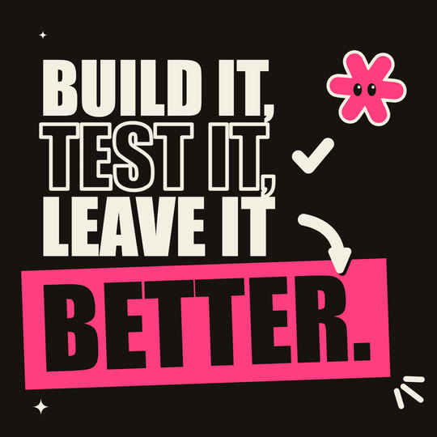

# Kinetic type

Type-led motion for reels and launch posts. Huge, bold, condensed words in ALL CAPS fill the frame on a flat ground: a warm black, an off-white paper or a signal yellow. There is **one** pop colour, and it marks only two things: the keyword, as a box behind ink text, and a sticker. Flat die-cut stickers (an asterisk, an arrow, a dot, a tick, an underline swipe, emphasis marks) are the only decoration, and the hero is a pop asterisk with eyes. Motion runs on 1s and snaps: words slam in, stacks build from the centre, words flip to the next word, numbers count up, and the keyword's box swipes in behind it. There is no texture, gradient or blur: the type is the medium.

## Palette and meaning (`KIN` in kit.js)

| colour | hex | meaning | contrast (WCAG) |
|---|---|---|---|
| ink | `#17130f` | the warm black: the night ground, and every word on a light ground | paper on ink 16.1:1 |
| paper | `#f4efe4` | the off-white: the day ground, words on the dark ground, the stickers' die-cut rim, `STYLE.paper` | ink on paper 16.1:1 |
| signal | `#ffd319` | the loud ground (`kinGround('signal')`) | ink on signal 12.8:1 |
| pop | `#ff3d7f` | **the one pop**: the keyword's box, the hero, a sticker. Never text on a light ground | ink on pop 5.5:1 · pop on paper 2.9:1 · pop on signal 2.3:1 |

**The contrast rule:** text of 64 px or more must reach 4.5:1 against what is behind it. That is why the keyword is **ink text on a pop box**, never pop text: pop text on paper or signal fails. `kinOn(bg)` picks the text colour for any ground (the brand's `fg` when it passes, otherwise ink or paper, whichever contrasts more). The kit warns in the console if a brand accent leaves keyword text under 4.5:1.

**Brand tokens:** before the kit (for example in `src/options.js` listed before `"style"` in piece.json `"build"`), set `const BRAND = { bg, fg, accent, display, weight, squeeze }`. `accent` replaces the pop, `bg` becomes the default ground (`'brand'`), `fg` is used where it passes 4.5:1, and `display` is a system font family put at the front of the stack. `const KIN_GROUND = 'ink' | 'paper' | 'signal'` picks the default ground. Both are read with `typeof`, so pieces without them build unchanged.

## Type

- **Faces, system fonts only.** The display face is the first one installed from this list: Impact (Windows, macOS), Haettenschweiler, Arial Narrow, Liberation Sans Narrow, Nimbus Sans Narrow, DejaVu Sans Condensed, Arial Black, Helvetica Neue, DejaVu Sans, Arial (on Linux, Arial resolves to Liberation Sans). The kit detects the face once by comparing its metrics with the generic fallbacks (`kinHas`). A wide fallback is squeezed horizontally (Arial and Liberation Sans ×0.78, Helvetica Neue ×0.8, Arial Black ×0.78), so every OS sets the type narrow. `tile.mjs` prints the face it picked (`fonts ok: kinetic display face: Impact`).
- **Measured, never guessed.** `kinMeasure` caches `measureText` per string, font, tracking and direction. `kinFit(strs, maxW)` returns the size that sets a string (or the widest of several) exactly `maxW` wide, squeeze included. A layout fits each row to the column, then scales the whole stack to the height it has (see the demo's `demoFit`).
- **Sizes at 1080 wide:** rows 100–320 px, with the keyword the biggest thing in the frame. Captions are 56–72 px. Tags are 54 px. Nothing that must be read is under 54 px.
- **Rows:** ALL CAPS, leading of about 0.12–0.18 of a cap height between rows, no tracking with Impact. Each row is one of three kinds: `fill`, `outline` (a stroke of 3–3.5% of the size, at most one outline row per frame), or `key` (the box).
- **Right-to-left:** a string with Hebrew, Arabic, Urdu or Persian letters is set with `ctx.direction = 'rtl'` (or pass `dir: 'rtl'`). `kinFit` measures it that way. `kinWords` and `STYLE.caption` put the first word on the right. The keyword box swipes in from the right and wraps the string's own measured ink, because these letters climb and drop well past a Latin cap. The glyphs come from the OS's own fallback font, since none of the display faces has Arabic letters.

## Line, shape and texture

- **No texture:** no grain, blur, gradient, hatch or boil. Grounds are flat fills.
- **The keyword box** is a hard-edged pop rectangle padded 0.2 cap left and right, 0.17 cap above and 0.2 cap below, tilted 2–3° (`rot: -0.035`). Ink text sits inside it. **One box on screen per frame.**
- **Stickers** are flat shapes with a paper die-cut rim (8 px) and a hard ink shadow offset 7 px down-right (no blur). The shadow vanishes on the ink ground, and that's fine: the rim carries the sticker there. Stroked stickers (arrow, tick) use the same rim and shadow around the stroke.
- **The hero** is the asterisk: three rounded capsules through the centre (`kinAstPts`, sampled by angle, so it morphs cleanly). It is pop with a paper rim and two ink eyes with a paper glint. It turns slowly, bobs, blinks about every 2.6 s, looks at what it cares about, and squashes when it lands.

## Motion habits (on 1s: `ones: true`)

| move | helper | numbers |
|---|---|---|
| slam | `kinSlam(t0, key)` | scale 1.3 → 1 on easeOutExpo over 0.22 s, plus a 7 px seeded shake that dies within 0.32 s |
| center-build | `kinBuild(rows, { x, cy, gap, align })` | the new row's slot opens 0.16 s ahead (the rows above slide up on a stiff spring, k 600, d 40), then the word slams in. Rows never overlap |
| type-swap | `kinSwap([[t, 'MOVES'], [t2, 'POPS.']])` | the word folds shut (scaleY → 0, 0.08 s) and the next one opens on easeOutBack (0.16 s). The two are never on screen together |
| count-up | `kinCount(t0, d, a, b, { dec, sep, pre, post })` | easeOutExpo. Give the box `ref: '120'` so it keeps one size from 0 up |
| highlight swipe | `kinKey(str, x, y, size, { u: kinSwipe(t0) })` | the box wipes in with the reading direction on easeOutExpo over 0.28 s. Text under the box turns ink as the box passes |
| word-by-word | `kinWords(words, x, y, size, t0, step)` | each word pops 0.6 → 1 on easeOutBack (0.18 s), one every `step` |
| land | `kinHero(..., { land: t })` | a damped squash (`kinKick`) |

Words land on the beat grid (8ths = 0.25 s at 120 BPM). Each phrase then holds for at least 0.6 s. Idle life comes from the hero (bob, spin, blink), the beat meter (`kinMeter`), emphasis marks that wiggle on every beat (`kinMarks`) and twinkling sparkles. The camera stays still: the type moves, not the frame.

**Morphs:** `backdrop` doesn't blend the two grounds (that turns grey). The old ground stays while paper wipes across it on a hard slanted edge, then the new ground wipes in. `window` shows the era through the bridge outline with a hard ink offset shadow and a 10 px pop rim. `blob` is a solid block in the bridge colour with the same hard shadow. The natural bridge objects are **keyword boxes**: the box behind one word becomes the box behind the next (`demoRectPts` in the demo turns a tilted box into dense points). Boxes of similar proportions morph cleanly.

## Captions: `STYLE.caption(words, active, x, y, size, o)`

This hook is for `kit/captions.js` (word-lit captions from `VOICE`), and the kit's own `kinCaption` uses it too.
- `words`: an array of strings (or `{ text }` / `{ word }` objects); `active`: the index of the lit word (−1 for none); `(x, y)`: the chunk's centre on the baseline; `size`: px.
- `o`: `count` (how many words are shown, for a reveal), `since` (seconds since the lit word began: it pops 1.08 → 1 over 0.12 s), `maxW` (shrinks the chunk to fit), `align` (`'center'` | `'left'` | `'right'`), `dir` (`'rtl'`, also auto-detected), `upper` (default true).
- The look: the display face in caps, paper letters with a thick ink edge (13% of the size, painted under the fill), so a caption reads on any ground. The lit word sits on the pop box with ink text. When a keyword box is already on screen in that frame (scarce emphasis), the lit word gets a pop underline swipe instead.
- Returns `{ w, size }`. Keep chunks to 1–4 words and inside the 9:16 safe area (`kinArea()`).

## Frame checklist (on top of the skill's grammar/FRAME.md)

1. **Type is the subject:** letterforms cover about 40% or more of the frame. One stack, one column, one left (or centre) edge.
2. **One pop colour, used once:** on the keyword's box or a sticker. Never pop-coloured text on a light ground, and **never two keyword boxes on screen at once** (the kit enforces this).
3. **Contrast:** every word of 64 px or more is at 4.5:1 or better against what it sits on (ink on pop is 5.5:1). Check any brand colours with `kinContrast`.
4. **Fit, don't guess:** every row is sized by `kinFit` to its column, and the stack is scaled to its height. Nothing is clipped, and the text check passes on every format.
5. **Hierarchy:** the keyword is the largest thing on screen. Rows alternate fill and outline for rhythm, with at most one outline row.
6. **Every word lands on the grid** with a slam, a build, a flip or a pop. Nothing fades in.
7. **Holds of 0.6 s or more** after each phrase, with idle life during them (the hero, the meter, the marks).
8. **Flat:** no gradients, blur, glow or grain. Sticker shadows are hard offsets.
9. **Phone-safe:** on 9:16, type sits in x 120–780, y 288–1248 (`kinArea()`). Big decoration such as an outlined asterisk may sit under the UI.

## Kit API (`kit.js`, on top of `kit/core.js`)

- Palette and contrast: `KIN`, `KIN_GROUNDS`, `kinGround(name)` (fills the frame, sets `kinFg()`), `kinOn(bg)`, `kinContrast(a, b)`, `kinLum`, `kinRGB`, `kinHex`.
- Type: `KIN_FACE`, `kinFont(size)`, `kinMeasure(str, size)`, `kinFit(strs, maxW, { max })`, `kinW(str, size)`, `kinCapK()`, `kinText(str, x, y, size, { align, color, stroke, sw, edge, ew, k, sy, rot, dx, dy, al, dir, track })` (returns its box), `kinKey(str, x, y, size, { u, ref, rot, k, sy, padX, padY, padB, shadow })`, `kinBoxRect`.
- Motion: `kinExpo`, `kinBack`, `kinKick`, `kinPulse(t0, every)`, `kinShake`, `kinSlam`, `kinPop`, `kinSwap`, `kinCount`, `kinNum`, `kinSwipe`, `kinBuild(rows, o)`, `kinBuildAt(rows, o)` (settled baselines, for bridge shapes), `kinSlot`, `kinRow`, `kinWords`.
- Stickers: `kinDie(path, fill)`, `kinDieLine(path, color, w)`, `kinPath(P)`, `kinAstPts(x, y, r, { arms, w, rot })`, `kinAsterisk(x, y, r, { fill | outline })`, `kinDot`, `kinArrow(x0, y0, x1, y1, { bend, frac, w })`, `kinTick(x, y, r, { frac })`, `kinUnderline(x0, y, w, u)`, `kinMarks(x, y, r, dir, t0)`, `kinMeter(x, y, n, s)`.
- Hero: `kinHero(x, y, r, { key, look, land, spin, at, blink })`. It sets `SPARK_AT`.
- Layout and overlays: `kinArea()` (the type area of the current format), `kinTag(str)`, `kinCaption(words, t0, { step, x, y, size, maxW })` (through `DEFER`).
- `STYLE`: `paper` (`KIN.paper`), `backdrop` (flat, with a hard slanted wipe in morphs), `window`, `blob`, `hero`, `heroColor` (the pop), `heroPts` (the asterisk outline), `caption`, `post` (resets the one-box guard and the ground), `ones: true`.

## Do / don't

- **Do** write the line first and pick the keyword. It gets the box, the biggest size and the hero's attention.
- **Do** act the line out with type: a struck-out word that flips to the right one, a tick after "TEST IT", a number that counts up.
- **Do** keep the whole piece on one ground per era. Change the ground across a morph (ink → paper) for a still-visible signature per era.
- **Don't** colour text with the pop, add a second accent colour, or put a box behind two words in one frame.
- **Don't** fade type in or out. It lands (slam, pop, flip) and it leaves on a cut or a morph.
- **Don't** set type with a hard-coded size. Fit it, or a Linux fallback face will run off the frame.

## Not matched / known limits

- **Fonts differ by OS.** Windows and macOS set Impact. A bare Linux (only Liberation and DejaVu installed) falls back to Liberation Sans Bold squeezed to 0.78, which is lighter and rounder than Impact. Sizes are fitted, so the layout holds, but the colour of the type changes. Checked in the Playwright Linux image.
- **Right-to-left glyphs** come from the OS's fallback font (no display face has Arabic letters). They are not condensed, and the stack's slots are sized from the Latin cap height, so give Urdu rows extra gap.
- **The morph's in-between** only blends outlines by angle. Keyword boxes morph cleanly, but a box into a long thin underline would pinch.
- **Caption chunks** are set on one line and shrunk to `maxW`. Splitting phrases into chunks is the caller's job (`kit/captions.js`).

## Credits

- No code was ported. The brand-token idea (an optional `{ bg, fg, accent, display }` theme read by the style) and a hot-pink pop on a near-black ground come from HeyGen's HyperFrames theme contract (Apache-2.0): https://github.com/heygen-com/hyperframes. This is an idea and a palette direction only. Our hex values, code and token names are our own.
- easeOutExpo and easeOutBack are the standard easing curves (as listed on https://easings.net). The asterisk outline (a union of capsules sampled by angle), the stickers and the layout code were written for this kit.

## Proven on

`demo/` (6 s, 9:16 main plus 1:1 and 16:9, 120 BPM, 24 fps). Night: TYPE / THAT / MOVES center-build on the warm black, MOVES flips to POPS., the pop box swipes in and the hero hops onto it. The box morphs at 3.0 s into the box behind a count-up on paper by day: 120 / BEATS A MINUTE / 24 FRAMES / A SECOND. It is deterministic, the text check passes on all three formats, and review.mjs passes (story arc, dead beats, text). Also the README gallery tile `docs/gallery/11-kinetic` ("Build it, test it, leave it better.", 1:1, 3 s). It has not yet carried a full piece.
