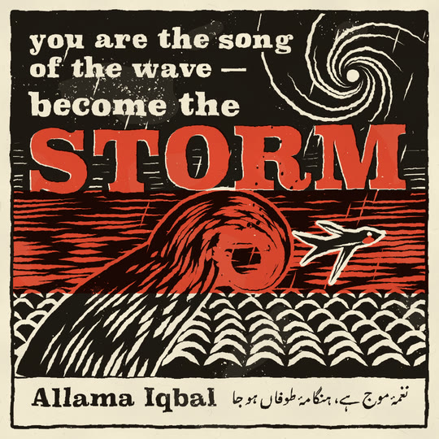

# Linocut

A hand-carved relief print: warm black ink and **one** second ink (vermilion) on cream paper. Nothing is drawn as a line; shapes are blocks of ink defined by the white gouge marks carved out of them: V-gouge cuts that taper at both ends and U-gouge scoops, always following the form (flow lines along a wave, spiral arms round a storm, scallops for a sea, echo cuts inside an edge, tonal hatching whose cut width is the light). Every frame is a fresh pull of the print: the cut edges are never machine-straight, the ink breaks into pinholes where the roller ran starved, the red block lands a few pixels off register, and the inks multiply onto the paper. Lettering is bold wood-type slab, each letter set a little off by hand. It belongs with the handmade, printed styles (riso, cut paper, crosshatch): two flat inks, real texture, no gradients, no glow.

## Palette and meaning (`LINO_PAL` in kit.js)

| colour | hex | meaning |
|---|---|---|
| paper | `#efe6d0` | the sheet; every white in the picture is paper showing through a cut |
| ink | `#1e1813` | the key block: warm black, never pure black |
| red | `#d8432b` | the second block, **one meaning per piece**: the light the story follows (the sun, a lit window, the hero's throat; in the tile, the storm) |
| red over ink | (multiply) | near-black with warmth: where the blocks overlap, black wins |

The inks are stored as multiply factors over the paper (`LINO_KF`, `LINO_RF`), so a print can only darken what is under it; a caption over a black ground needs the paper label the kit lays under it. No hue between 220° and 330° anywhere.

## Line and texture

- **Cuts, not strokes.** `linoGouge` builds a tapered polygon around a polyline: `'v'` widens past the middle and leaves sharp, `'u'` enters round and flicks out. Widths are 4-15 px at 1080. The block is carved once: cut geometry is seeded by its key, never by `B`.
- **The press (`linoPrint`).** The scene draws coverage on two full-size plates; one pixel pass gathers each plate through a seeded warp of about ±2 px (nearest sample, so the steps read as tool nicks), breaks the black with crisp pinholes that crowd where the roller ran starved, gives the red a finer "salt" mottle, offsets the red by 2-4 px, and multiplies both onto the paper. It reads three variants keyed on `B % 3`, so a held frame boils like re-printed frames.
- **Paper:** cached per frame size: cream with a fine tooth, soft mottle, fibres and specks.
- **Separation:** a black figure on a black ground gets a carved white contour (`halo`); letters cut out of a textured field get a solid margin (stroke the text in ink first, then cut it).
- **Chatter** (`linoChatter`): faint broken ridges left in a cleared area.
- **Lettering:** `Superclarendon` (macOS), then `Rockwell Extra Bold` / `Rockwell` (Windows with Office), `Georgia`, `DejaVu Serif`; 700-900 weight; each glyph jittered in lift, tilt and size, seeded per letter. A real `fillText` on the plate, so the text check reads it.
- **Urdu (or any right-to-left line):** `linoUrdu` sets one shaped string with `direction = 'rtl'` in a Nastaliq face (`Noto Nastaliq Urdu`, `Urdu Typesetting`, `Jameel Noori Nastaleeq`). `linoUrduFont()` probes the machine (a font is present when it changes the measured width against both the `monospace` and `serif` fallbacks) and returns `null` otherwise: leave the line out then, don't fall back to a Naskh face.

## Motion habits

- **On 2s** (`ones: false`). Every pull boils (three print variants); the carving itself doesn't.
- **Printed in:** things arrive by the roller pass (`linoRoll(u, box, fn, { dir })`), a reveal with a ragged band of streaks at its leading edge, not by fades. Tags and captions roll in.
- **Moving things move in the block:** a wave rises and its curl turns (`linoWave` `rise`, `turn`), spiral arms rotate, scallops drift, spray and smoke are U-gouge stabs on a loop, rain is diagonal cuts falling; the swallow flaps on a four-drawing cycle.
- **Morphs:** the old world closes through a carved ring (a black band with radial gouges); on the paper the bridge shape is a carved block (black, or red when the bridge colour is nearer the red) with echo cuts and light from the top left; the new world opens through the counterpart's ring.

## Kit API (`kit.js`, on top of `kit/core.js`)

- Press: `linoPaper()`, `linoPrint(fn, { box, alpha, reg, v })`, inside it `linoRed(fn)`, `linoCarve(fn)`, `linoKnock(fn)` (cut both blocks), `linoV()`.
- Cuts: `linoGouge(P, w | w(x, y), { kind, a, b })`, `linoCuts(list, { w, kind, clip, ink, step })`, `linoHatch(clip, { a, gap, w, tone(x, y), len, skip, wave })`, `linoEcho(P, { n, gap, w })`, `linoSpiral(cx, cy, r0, r1, { arms, turns, rot, w, clip })`, `linoScallops(x0, x1, y0, y1, { size, gap, grow, shift, clip })`, `linoDots(pts, { ink, flat })`, `linoChatter(x0, y0, x1, y1, { n, al, a })`.
- Shapes: `linoBlock(P, { halo, wob, key })`, `linoWob(P, amt, key)` (a static hand-cut wobble), `linoWave({ base, curl, r, w, rise, turn, n, cw, foam, halo })` → `{ P, tip, crest }`, `linoRing(P, w)`.
- Type: `linoText(str, x, y, size, { carve, weight, align, track, tilt })`, `linoTextW`, `linoUrdu(str, xRight, y, size, { carve })`, `linoUrduFont()`, `LINO_FONT` (override with `const LINO_FONT_STACK = '...'` before the kit).
- Reveal: `linoRoll(u, box, fn, { dir: 'right' | 'left' | 'down' | 'up', band })`.
- Hero: `linoBird(x, y, s, { flap, tilt, halo, key })`: a carved swallow (black block, gouged wing feathers, a white eye, the throat cut out and printed red); `linoBirdPts` for its outline. Sets `SPARK_AT`.
- Captions (`DEFER`): `linoTag(str, { x, y, t, size })` (a black block with its words cut out, on a paper label, top left), `linoCaption(str, { x, y, t, size, label })` (black letters with a carved rule).
- `STYLE`: `paper`, `backdrop` (the paper tinted toward c), `window` (a carved ring), `blob` (a carved block), `hero` (the swallow), `heroColor` red, `heroPts`, `post` (nothing: the press does it), `ones: false`.

## Frame checklist (on top of grammar/FRAME.md)

1. **Two inks and the paper, nothing else.** Black, vermilion, cream; overlaps go black. No tints, gradients, glows or a third colour.
2. **Every shape is cut, not drawn:** its light comes from gouge marks that follow its form (flow, spiral, scallop, echo or tonal hatch). A flat black shape with no cuts is a silhouette, not a linocut.
3. **The print shows at phone size:** pinholes in the black, ragged cut edges, the red a few px off register (a sliver of red and of paper along its edges).
4. **Red means one thing** in the piece and covers a small area or one bold block.
5. **Black on black is separated by a carved white contour** (the hero over a dark sky, a wave over the sea).
6. **Letters are carved wood type,** ≥ 60 px at 1080, cut out of a block (paper letters) or printed on paper; never a UI sans.
7. **Things arrive by the roller,** not by fading.
8. **The print boils, the block doesn't:** step through frames: textures and edges shift every two frames, the cut marks stay put unless the thing moves.
9. **Captions over a dark ground sit on their paper label** (the kit lays it); nothing that must read is printed red on black at small sizes.

## Do / don't

- **Do** pull one `linoPrint` per scene and draw everything in it; each extra print over a big box costs a pixel pass.
- **Do** give every cut list a `key` and keep `B` out of the geometry, except for things that really move.
- **Do** clip cut lists to their shape (`clip`) so gouges never run past an edge into a neighbour.
- **Don't** use `globalAlpha` to fade something on a plate: partial coverage prints as a grey screen. Skip it, or roll it in.
- **Don't** print a dark tag over a dark ground without the label; the multiply can't lighten.
- **Don't** copy a specific print's composition (the claw wave with a mountain, a known artist's birds). Take the genre.

## Performance (measured)

Headless Chromium (Playwright), Apple M3 Pro, `tile.mjs` timings: the 1:1 tile 33-63 ms a frame warm; the demo at 9:16 (1080x1920) 47-84 ms (morph frames with a ring print about 75 ms), 1:1 33-44 ms, 16:9 56-73 ms. The first frame of a page costs 0.5-0.9 s (the paper, the noise fields and the plates are built once per frame size). The cost is the pixel pass, which grows with the printed area: limit small prints with `box`. 9:16 runs a little over the ~60 ms aim; a quarter-res warp field or a GPU pass would be the next step.

## Not matched / open

- The warp and ink texture are screen-space: a camera pan keeps the paper still while the block moves, like re-printing each frame on the same sheet. A long pan would want world-anchored fields.
- Superclarendon is macOS-only; Windows without Office and Linux fall back to Georgia / DejaVu Serif Bold, which read as type rather than wood type. Lay out text for the widest face (Superclarendon) or fit it.
- The Urdu line appears only where a Nastaliq face is installed (macOS ships Noto Nastaliq Urdu).

## Credits

Original code; no third-party code was ported. The look is the relief-print genre (linocut and woodcut), studied as a medium, not from any one artist's work. The swallow, the wave construction, the press model and the palette are this kit's own.

## Proven on

This demo (`demo/`: 6 s, 9:16 with 1:1 and 16:9, 120 BPM at 24 fps: a wave rises under a red sun and the swallow skims it; the sun becomes the moon over a cottage at night, its window lights red and the swallow lands on the roof; deterministic, review passes) and the gallery tile `docs/gallery/18-linocut` ("Become the storm").
