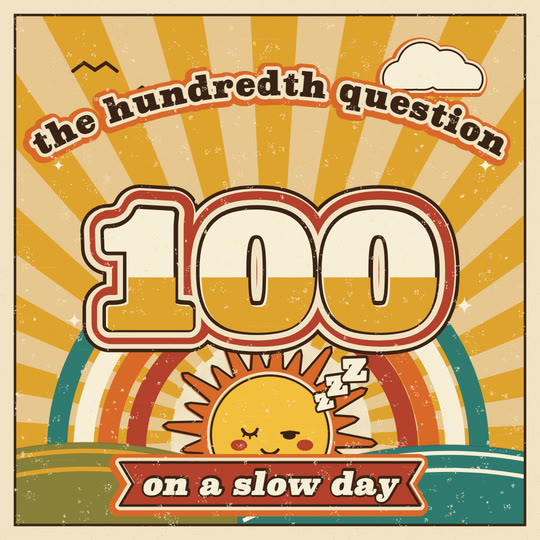

# 70s screenprinted poster

A 1970s screenprinted poster. A few flat spot inks (mustard, burnt orange, brick, brown, olive, teal and cream) are pulled one screen at a time onto warm cream stock. Every ink sits a few px off register and shifts a hair with each pull, ink builds up at the stencil edge, and pinholes and paper tooth show through. The sheet carries sunbursts, rainbow bands and stripes, and big, heavy, round-shouldered type with echo outlines (the lettering repeated in offset bands). A sun with a 70s face is the hero. Any fade is done with halftone dots. There are no gradients, glows or black. Motion is on 2s: rays turn slowly, bands slide in and type stamps.

## Palette and meaning (`PST` in kit.js)

| ink | hex | meaning |
|---|---|---|
| paper | `#f1e3c4` | the stock: every knockout and gap between echo bands shows it |
| cream | `#f8eed6` | cream ink printed over colour: type faces, highlights, egg white |
| brown | `#3a2216` | the key: outlines, eyes, mouths, rules. The darkest thing in any frame (never black) |
| sun | `#f4bf3e` | **the hero's gold, reserved for the sun / yolk disc** |
| mustard | `#dfa22e` | rays, the lower half of two-tone letters, stripes |
| orange | `#d9682a` | the hero's rays and band, echo bands, the gingham screen |
| brick | `#b4402d` | outer echoes, cheeks (off register), tags, ribbons |
| cocoa | `#6e3b22` | a second brown for objects (a pan, a handle) |
| olive | `#87803a`, teal `#2f7a70` | hills, stems, the cool counterpoint (teal is the outer rainbow band) |
| tan | `#e7c690` | the quiet ink: the ground under the rays |

All hues fall between 6° and 175°, so there is no violet. Each ink has a fixed registration offset (`PST_REG`, px at 1080) plus a ±0.8px wobble per pull (`B`). The key (brown) and the stock never move. `const PST_MIS = 1.5` before the kit scales the misregistration.

## Line, texture, type

- **Flat fills only.** `pstFill` prints one ink at its registration and strokes a darker rim (24% toward brown, 2.4px, alpha 0.55) where ink builds up at the stencil. `o.over` prints a transparent overprint (multiply): two orange screens make a brick gingham.
- **The key line is separate from the fill.** `pstShape` prints the echo rings, then the fill (off register), then a brown key line on the true outline. The sliver of paper on one side and the overrun on the other is the look.
- **Echoes**: rings `[[ink, width], ...]` from the shape outward, drawn as stacked strokes from the outside in. `'paper'` makes a knocked-out gap. A typical stack is brown 8, paper 11, brick 15.
- **The print pass** (`STYLE.post`): a cached sheet of pinhole clusters in the paper colour, dry squeegee streaks and dark tooth, laid over the whole frame at a new offset each pull. Over the stock it disappears; over ink it reads as skips. The paper (`pstPaper`) is a cached mottle with fibres and specks.
- **Halftone** (`pstHalftone`) is the only way to fade: dot area = tone, 14px pitch, 45°.
- **Type**: a heavy serif per OS (`"Cooper Black"` with Office, Superclarendon on macOS, Bookman / TeX Gyre Bonum on Linux, then Rockwell and Georgia), weight 900. `pstType` fattens it with a round-joined stroke (`fat`, 1.5-3% of the size) so any of them reads soft. `split: [ink, share]` prints the lower part of each letter in a second ink (the 70s two-tone). `pstArcType` sets a word along an arch. `pstFit` shrinks a line to a width; fonts differ by OS, so always fit.

## Motion habits

- **On 2s** (`ones: false`). The drawing never wobbles; the *print* moves: registration and pinholes change each pull, so a held frame shimmers like a stack of prints flipped on 2s.
- **Sunbursts turn slowly**: about 0.07 rad/s for a full-bleed burst, 0.3 rad/s for the hero's crown.
- **Bands slide in**: `pstRainbow(..., { sweep })` sweeps each arc open with the inner band first; `pstStripes(..., { frac, stagger })` writes stripes on.
- **Type stamps**: `pstStamp(t0)` gives one pull big (1.05-1.32), the next a size under (0.95), then settled, and the echo rings ripple out (`grow`). `pstHitTicks` adds short brown impact dashes. Stamp digits one by one with per-run scales (runs `[text, x, y, rot, scale]` and `pivot`). Keep `big` near 1.05 for arched or wide lines so the overshoot stays inside the safe area.
- Heroes rise on `SPRING.heavy`. Clouds and gulls drift 10-22 px/s, gulls flap every 2 pulls, daisies sway, twinkles pulse.

## Kit API (`kit.js`, on top of `kit/core.js`)

- Inks: `PST`, `PST_REG`, `PSTF` (font stack), `pstInk(ink)` gives `[colour, dx, dy]`, `pstMix`, `pstA`, `pstRGB`.
- Sheet: `pstPaper(c)`, `pstPrint()` (the post pass), `pstCanvas(key, w, h, draw)` (static cache).
- Geometry: `pstPath`, `pstCentre`, `pstWavy(P, amp, freq, phase)`, `pstOffset(P, d)`, `pstPuff(x, y, rx, ry, lobes)`.
- Printing: `pstFill(P, ink, { over, edge })`, `pstShape(P, ink, { rings, kw, inner, grow })`, `pstRings`, `pstLine(P, ink, w, { frac })`, `pstStripes(P, inks, w, { gap, frac, stagger })`, `pstRainbow(cx, cy, r, inks, w, a0, a1, { gap, sweep, stagger })`, `pstSunburst(cx, cy, n, rot, [ray, base], { r0, r1, duty, swirl })`, `pstHalftone(P, ink, tone, { pitch, angle, box, over })`.
- Type: `pstType(str, x, y, size, { fill, rings, fat, split, grow, s, rot, runs, pivot, italic })`, `pstArcType(str, cx, cy, r, size, o)`, `pstTextW`, `pstFit`, `pstStamp(t0, { big, ripple })`, `pstHitTicks`.
- Hero: `pstSun(x, y, r, { mood: 'smile'|'happy'|'sleepy'|'wow', lid, lids: [l, r], yawn, look, rays, spin, band })`: a gold disc in a knocked-out ring and an orange band, a crown of long and short rays, brown eyes (shut eyes get lashes), brick cheeks off register, and a grin with a brick tongue, an O or a small smile. `rays: 0` makes a yolk or a face in a window. Sets `SPARK_AT`.
- Life: `pstBird`, `pstCloud`, `pstTwinkle`, `pstDaisy`.
- Captions: `pstCaption(str)` (a cream ticket with an orange echo; on 9:16 it is centred at x 450, y 1160, at most 640 wide, inside the platform union), `pstTag(str)` (a brick ticket, top left of `SAFE`). Both go through `DEFER` and hide while a bridge is closing or opening (`pstBridgeK`).
- `STYLE`: `paper` the stock; `backdrop` paper in any colour; `window` the world through an opening framed in rainbow bands (brown, orange, mustard and brick, with paper gaps) and a key line; `blob` a sunburst disc in the bridge colour, its rays turning with the morph (`pstSunDisc`); `hero` the sun; `heroColor` gold; `heroPts` its disc; `post` the print pass; `ones: false`.

## Frame checklist (on top of grammar/FRAME.md)

1. **Five or six inks, all flat.** No gradient, glow, shadow blur or black anywhere. Fades are halftone dots.
2. **Misregistration shows**: fills sit off their brown key lines, and cheeks and echoes sit off their shapes. Check a 2x crop.
3. **The print pass is on**: pinholes are visible in large ink areas at phone size.
4. **At least one echo**: the headline or the hero has stacked bands with paper gaps.
5. **A radiating or banded structure carries the composition**: a sunburst, a rainbow, stripes. It moves (turns or slides) but is quieter than the type and the hero (tan / mustard behind cream and brown).
6. **The type is heavy, round and fat-stroked**, set big, fitted to its width, and in a cream / brown / echo combination that reads at 380px.
7. **The sun's gold is only on the hero.**
8. **Something prints on the beat**: a stamp, a band sliding in, a ray turn. Held frames still shimmer from the pull.

## Do / don't

- **Do** print back to front: ground, rays, bands, hills, hero, big type, ribbons, captions. Opaque inks cover what printed before.
- **Do** give bands paper gaps; touching colour bands read as a gradient at phone size.
- **Do** fit every line (`pstFit`) and keep stamp overshoot small near the safe edges. The text check sees each arched glyph on its own.
- **Don't** fade a prop with `globalAlpha`. Print it smaller, or don't print it.
- **Don't** spend mustard rays next to a mustard band (they merge); pick the rainbow's inks against the rays.
- **Don't** copy psychedelic acid palettes (magenta, violet): this look is the warm earth-tone screenprint.

## Not matched / known limits

- Ink edges are clean vector edges with a darker rim, not truly ragged; real screenprint bleed is not simulated per edge.
- Overprints are only where asked (`over`). Most inks print opaque.
- Fonts differ by OS (Cooper Black, Superclarendon or Bookman), so line widths change; layouts must fit to width.

## Credits

The echo bands (a shape's outline stroked in stacked widths from the outside in), the alternating sunburst wedges and the wavy normal-offset outline are adapted from the 70s-poster kit (`styles/70s-poster/kit.js`, "Groovy") of **illodev/drawn-by-code**: https://github.com/illodev/drawn-by-code, MIT (code only; its fonts, sound effects and rendered media are excluded and none are used here). Adapted at commit `3c9c949421e4aa86dba444dfe8cba46d000f9d87` (last change to that kit: `29a33f00034973b0dffc4e15f45179c4e6597e07`). The palette, registration, print pass, halftone, type, hero and every other part are new to this kit, and they use our `RNG` and system fonts.

## Proven on

This demo and the gallery tile.
- `demo/` (6s, 9:16 main, 1:1 and 16:9, 120 BPM, 24fps): the sun rises on a heavy spring over striped hills inside rainbow bands, wakes, and "good morning" stamps along an arch. At 3.0s the sun's disc morphs, through a band-framed opening and a sunburst-disc blob, into the yolk of an egg frying on a gingham cloth ("sunny side up"). Tiles are deterministic in all three formats; text PASS in all three; review PASS.
- `docs/gallery/21-poster` (1:1, 3s): "the hundredth question / 100 / on a slow day", with a sleepy sun.
