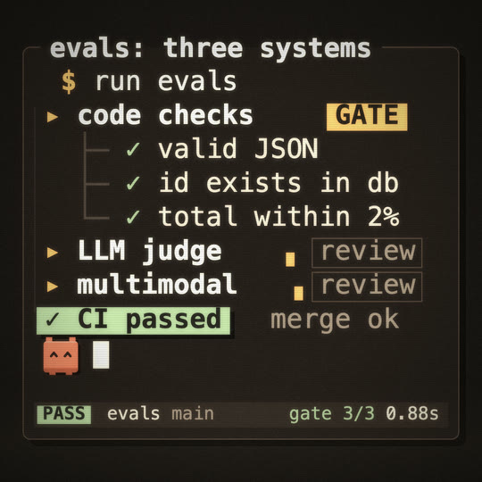

# Terminal

A warm, crafted developer terminal for dev-tool videos, CLI launches and "how it runs" explainers. A warm black ground, cream and amber monospace text on a character grid, one terracotta accent kept for the hero (the caret come alive) and a muted sage for success. Everything that must read is real text: commands typed at a human rate, output that arrives line by line, progress bars and spinners made of block characters, ASCII boxes and arrows, a status line. A light CRT finish sits on top: a tight phosphor glow on what is brighter than the ground, faint scanlines, a slow refresh band, a gentle vignette. Not hacker green, not neon, not a glossy app window.

## Palette

`TM` in `kit.js`. Every hue sits outside 220-330°.

| name | hex | means |
|---|---|---|
| ground | `#1b1714` | the warm black ground; the blank sheet a morph happens on; text on chips |
| pane | `#221c18` | a terminal pane, one step up from the ground |
| bar | `#2e2620` | the status line, chips at rest |
| edge | `#5a493c` | pane frames, box lines, arrows |
| shadow | `#0c0907` | hard offset shadows (printed, never blurred) |
| faint | `#4d4137` | rules, tree lines (`├─ └─`), the empty part of a bar |
| dim | `#9d8c77` | comments, secondary output, `review`, the status line |
| text | `#e4d8c1` | output |
| cream | `#f6ecd7` | commands, headings, the caret |
| amber | `#ecb163` | the prompt `$`, `▸` markers, keywords, progress, a GATE chip: what to read next |
| **terra** | `#d97757` | **the hero only** (the caret critter); never decoration |
| sage | `#a7bf8f` | success: `✓`, PASS / DONE chips, "CI passed" |
| fail | `#d2574a` | a failed check (`✗`), sparingly and never beside the hero |

## Type, line and texture

- **Monospace only**, from a stack per OS: `"SF Mono"` / Menlo / Monaco (macOS), Consolas / Cascadia Mono (Windows), DejaVu Sans Mono / Liberation Mono (Linux). The face in use is measured once (`TM_M`: column width, the block glyph's box, cap height) and everything is laid out in columns, so every OS sets the same grid. `tile.mjs` prints the face (`fonts ok: terminal face: Menlo`).
- **Weights:** 400 for output, 700 for commands' keywords, tier names and chips.
- **Sizes at 1080 on the short side:** 44-50px for a pane of 22-24 columns on 9:16 (it has to fit left of the action rail), 56-64px on 1:1, 60px for anything that must read on a 380px tile. Line pitch 1.27-1.4 x the size.
- **Lines** are hairlines on the grid (2-3px), rounded corners like `╭╮╰╯`, titles set into the top edge of a frame (TUI style). Boxes and panes get a hard offset shadow (10-16px), never a blur.
- **Chips** are inverse video: a cell-high block behind the text (amber = a gate / a keyword, sage = passed, faint = idle).
- **The finish** (`STYLE.post`, about 3-6 ms): glow 0.3 (the frame at quarter resolution minus the ground, blurred 1.25px there, added with `lighter`), scanlines every 4px at 0.12, a refresh band at 0.03, grain 0.05, vignette 0.42. `const TM_CRT = { ... }` before the kit tunes it; `TM_CRT = false` turns it off.

## Motion habits

- **On 1s** (`ones: true`): typing needs every frame. `tmTypeTimes` gives each key its own seeded time at about 12-15 keys a second (a breath at word boundaries, the odd hesitation); the score reads the same times for its key clicks.
- **Output arrives whole, line by line** (`tmLine(G, r, segs, t)`), 0.1-0.15s apart; a check shows a spinner for a moment, then its tick stamps in. Chips stamp (1.25x -> 1 in 0.16s).
- **The caret** is solid while typing and blinks 0.53s on / 0.53s off after.
- **A pane turns on like a CRT** (`tmPane(..., { open })`): a bright line spreads, then opens to full height with a flash.
- **The hero** squashes on each keystroke, watches the output (eyes follow it), hops (springy arc, a squash on landing) and goes happy (`^ ^`) on success. Idle: a slow bob and a blink every couple of seconds.
- **Background life**: spinners still turning on work that doesn't block, a status-line clock, a filling bar, flowing dashes on arrows, the refresh band, the caret.

## Kit API (`styles/terminal/kit.js`)

- Grid and text: `tmGrid(x, y, size, lh)` -> `{ X(col), Y(row), cw, lh, top, bot, cap }`; `tmFit(cols, rows, w, h, { max, lh })`; `tmArea()` (the safe area, with the 9:16 rail); `tmText(str, x, y, size, color, { wt, count, bg, pad, al })`; `tmLine(G, r, [[col, str, color, o]], t)`; `tmCW(size)`, `tmCellH(size)`.
- Typing: `tmTypeTimes(str, t0, cps, key)`, `tmTyped(...)`, `tmTypedEnd(...)`, `tmKeyKick(...)`; `tmPrompt(G, r, cmd, t0, { cps, key, enter, hero, sym, heroK, heroO })` (the critter as the prompt, the command, the caret).
- Pieces: `tmCaret`, `tmSpin` (`▖▘▝▗`), `tmBar(x, y, size, cols, frac)` (`▕████▋░░░▏`), `tmPane(x, y, w, h, { title, right, open, inner })`, `tmFrame`, `tmBox(x, y, w, h, { title, fill, line, shadow })`, `tmRule`, `tmArrow(x0, y0, x1, y1, { flow, frac })`, `tmStatus(x, y, w, size, left, { right })`.
- The hero: `tmCritter(x, y, s, { mood: 'idle' | 'happy' | 'wow', look, lookY, squash, hop, hopH, walk, key })` (sets `SPARK_AT`).
- Captions (DEFER): `tmTag('01 build')` (an amber chip, top-left of the safe area), `tmCaption('brief in, film out')` (typed on at the bottom, `›` prompt, at least 50px, left of the rail on 9:16).
- STYLE hooks: `backdrop` = a flat fill; `window` = the world through the outline with a cream hairline and four amber corner brackets (a pane opening); `blob` = the outline filled cell by cell on a character grid (quadrant resolution, half-tone edge, seams, a few characters cut out); `hero` = the critter; `heroPts` = its body; `post` = the CRT finish; `ones: true`.

## Frame checklist (on top of grammar/FRAME.md)

1. **Everything that must read is text** drawn with `fillText` (textcheck sees it), at least 44px on 9:16 and 60px on a gallery tile, inside the safe area; on 9:16 left of x 780 below y 840.
2. **One grid.** Every line sits on the pane's columns and rows; no free-floating type. Glyphs outside ASCII (`✓ ▸ █ ├`) get their own run so a fallback face can't shift a column.
3. **Terracotta is the hero's alone.** Gates and keywords are amber, success is sage, everything else cream / dim.
4. **Something is printing, typing or turning** in every held frame: a spinner, the caret, a clock, a bar, flowing dashes.
5. **The idea is acted out in output**, not labelled: a check that gates gets a GATE chip and decides the CI line; one that only informs says `review` with its spinner still turning.
6. **Few lines, big type.** A pane of at most ~24 columns and ~9 rows; cut words before shrinking type.
7. **The medium shows at phone size:** the pane frame with its title in the edge, chips, block-character bars, scanlines and glow, but the finish stays subtle (no bloom you can see as a halo).
8. **Shadows are hard offsets**, never blurred; nothing glossy, no gradients on surfaces.

## Do / don't

- **Do** type commands at a human rate and print output whole; computers print, people type.
- **Do** keep a pane to 22-24 columns on 9:16 and fit the size to it (`tmFit`); a wider pane gets cut by the phone UI.
- **Do** let the hero be the prompt (or the caret); when it leaves a prompt, leave a `$` behind.
- **Don't** use hacker green, neon cyan or a glowing gradient ground; don't draw macOS window buttons or any real product's chrome.
- **Don't** blur text for "glow" per string (`shadowBlur`); the post pass already does it once for the frame.
- **Don't** draw text glyphs for the hero or the morph block: they are rects (the textcheck would see them as overlapping strings).

## Credits

No code ported. The scanline + phosphor finish is an idea from cool-retro-term (https://github.com/Swordfish90/cool-retro-term, GPL-2.0/3.0): the idea only, no code or values copied.

## Proven on

This demo (6s, 9:16 / 1:1 / 16:9: a pane turns on, `make film` is typed and its build prints; the film.mp4 block of characters becomes the film.mp4 box of an ASCII pipeline) and the gallery tile `docs/gallery/20-terminal` ("evals: three systems"). It has not carried a full piece yet.
