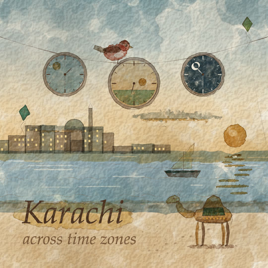

# Watercolor

Loose watercolour illustration on warm cold-press paper. Every coloured area is a translucent wash glazed over what is under it (multiply, so blue over ochre goes olive and overlaps darken like real glazes). Each wash is many low-alpha deformed polygons, so its edge frays in some runs and stays crisp in others. Pigment pools into a darker rim where an edge is crisp, and the wash mottles inside. Backruns, granulation and white paper left for highlights come with it. A fine sepia dip-pen line, or a pencil underdrawing, sits in places. The paper's tooth lies over everything. Warm earth palette, motion on 2s: washes bloom in from a point like wet paint spreading, then dry a shade lighter; things drift and bob; the pen boils a little.

## Palette and meaning (`WC` in kit.js)

| colour | hex | meaning |
|---|---|---|
| terracotta | `#c0573a` | **the hero, only the hero** (the sparrow's body and head) |
| paper | `#f3ebdb` | `STYLE.paper`: the warm sheet; white highlights are paper left bare |
| sepia | `#4a301f` | the pen line, lettering, eyes, clock hands (never black) |
| sepia wash | `#7d5a3c` | wood, the sparrow's wing, cap and tail, shadows, a second line of type |
| graphite | `#6e665e` | the pencil underdrawing |
| ochre / ochre light / naples | `#c98f35` / `#e7c47e` / `#f0d9a6` | sun, glow, sails, lit windows, swashes behind type, warm walls |
| sand | `#d8b57c` | beaches, tables |
| sap / sap dark | `#6e8a3a` / `#4e6a2b` | land, leaves, stems |
| teal / teal light | `#2e7a74` / `#8dbcb2` | deep water, hulls, cloth, glass |
| sky / sky deep / night | `#86afc8` / `#3d6f8c` / `#23404f` | sky and sea (all below hue 220) |
| stone | `#9a8e7e` | frames, sills, clock rims |

No hue between 220° and 330° in the kit, the demo or the tile (no violet, purple or periwinkle). Keep pinks out: with multiply, blue over pink turns purple. Blue over ochre or terracotta goes to olive and brown, which is fine.

## Line and texture

- **The wash** (`wcWash`). The outline is resampled to about 12 segments, and each segment gets its own variance. About 45% of the runs are crisp (low variance) and the rest fray (high variance). The outline is deformed recursively 3 times: a midpoint moves by a Gaussian of length × variance, and its children inherit a damped variance. That gives the base shape. Then about 30 layers are drawn, each the base deformed 3 more times, filled at ~6% and its outline stroked at ~5%. Pigment pools where the outlines crowd, so crisp edges get a dark dried rim and frayed edges fade. Every 4 layers are seen through a mask of random circles (the mottle). After the layers come soft darker and lighter blotches, an optional graded fade (`grade`), lifts (`lift`: frayed holes of white paper), backruns (a pale cauliflower with a dark rim) and granulation specks.
- **Glazing:** washes draw with `multiply`. Paint lighter things (white glitter, lit windows) `source-over` in paper or naples, like gouache.
- **Pen** (`wcPen`): a filled ribbon that swells and thins along its length, tapers at the ends and skips where the nib lifted (`lift`). It boils on 2s through core `wobble`. Use 1.5-3 px at 1080. Draw it on edges that matter (a hull, a dial, a beak), not round every wash.
- **Pencil** (`wcPencil`): two faint graphite passes that run past their ends, for horizons and construction lines.
- **Paper:** a 512 px periodic cold-press tile (embossed value noise, lit from the top left), tiled straight with no mirror seams, plus a faint uneven tone. It is one canvas per frame size, laid over the whole frame in `post`.
- **Type:** an old-style italic serif (`"Palatino Linotype", Palatino, "Book Antiqua", "URW Palladio L", P052, Georgia, serif`) in sepia, written on left to right over a loose wash swash (`wcSwash`). Never a UI sans.

## Motion habits

- **On 2s** (`ones: false`). Washes never boil; the pen line does, a little.
- **Bloom in:** `wcWash(..., { t, dur, from })` spreads a wet front from `from` over `dur` (0.4-0.6 s) on 2s. The wash reads ~30% darker while wet and dries back over 0.8 s.
- **Drift and bob:** clouds, boats, kites and gulls move by `ctx.translate` / `rotate`, so their sprites stay cached. A boat bobs 3-4 px and rocks ±0.05 rad, a kite sways, the curtain shears.
- **The hero:** bobs, breathes, blinks, twitches its head between a few angles in steps (as birds do), flicks its tail, hops (0.34 s arcs with a crouch and a landing squash) and flaps while airborne.
- **Morphs:** the old world closes through a soft, frayed opening with a pooled rim in the bridge colour (`window`). On bare paper the object is a live wash blob with a dark wet edge (`blob`), and the new world opens out of the counterpart.

## Kit API (`kit.js`, on top of `kit/core.js`)

- Colour: `WC`, `wcRGB`, `wcRgba(c, a)`, `wcShade(c, ±pct)` (all take `#hex` or `rgb()`).
- Outlines: `wcEll(cx, cy, rx, ry, n)`, `wcRect(x, y, w, h)`, `wcStroke(line, w0, w1)` (a tapered ribbon: swashes, reflections, necks), `wcInside`, `wcDeform`, `wcBase`.
- Washes: `wcWash(key, P, colour, { rough, spread, segs, layers, al, edge, mottle, mask, vary, grade: [x0, y0, x1, y1, a0, a1], lift: [{ P, a }], backruns, gran, resK, v, t, dur, from, dry, mode, alpha, cache })` and `wcWashLive(P, colour, key)` (uncached). Full-bleed grounds: `rough 0.06, step 90, resK 0.5` and a rect 160 px past the frame.
- Lines: `wcPen(P, { w, closed, frac, lift, amt, color, al, key })`, `wcPencil(P, { over, al })`, `wcSpatter(key, x, y, r, colour, n)`.
- Paper: `wcTooth()` (the post pass), `wcToothFrame()`.
- Props: `wcCloud(key, x, y, w)`, `wcGull(x, y, s)`, `wcWaveLine(x0, x1, y, { amp, len, speed })`.
- Hero: `wcBird(x, y, s, { key, dir, hop, fly, look: 'up' | 'down', mood: 'wow' })`: (x, y) is where its feet rest and s is about its body length. Sets `SPARK_AT`.
- Type: `wcText(str, x, y, size, { frac, align, color })`, `wcTextW`, `wcSwash(key, x0, x1, y, h, colour, { t })`, `wcTag(str)` (top left, ochre swash), `wcCaption(str)` (low centre, teal swash), both through `DEFER` and placed from `SAFE` / `UNIT`.
- Cache: `wcSprite(id, res, make)` over `WC_CACHE`.
- `STYLE`: `paper`, `backdrop` (a flat fill; the tooth goes over it in post), `window`, `blob`, `hero`, `heroColor`, `heroPts`, `post` (paper tooth), `ones: false`.

## Frame checklist (on top of grammar/FRAME.md)

1. **Every colour is a wash:** frayed somewhere, crisp and rimmed somewhere else, mottled inside. No flat vector fills apart from lit windows, white glitter and the dial ticks.
2. **White is paper.** Highlights are lifts or paper left bare (the sun's core, a sail, the sparrow's breast, sea glitter). Nothing glows.
3. **Washes glaze:** overlaps go darker and mix (multiply), like the sea under a boat or a blue glaze over ochre land.
4. **The pen is sparing and broken:** sepia, tapered, with skips. It only carries the edges that tell the story.
5. **The paper's tooth shows** at phone size in every frame, flat areas included.
6. **Terracotta is the sparrow's alone.** Oranges, suns and lamps are ochre or orange, never the hero's red.
7. **Warm and earthy:** no hue between 220° and 330°, no pink next to blue, no gradient grounds (skies are graded washes, mottled and frayed).
8. **Type is sepia italic serif** on a swash, at least 58 px at 1080 for captions and 60+ px on tiles.
9. **Motion on 2s:** washes bloom in from a point and then hold; idle life is drift, bob, sway, steam, glitter and the pen's boil.

## Do / don't

- **Do** build outlines in local coordinates and move them with transforms. A moved wash reuses its sprite; one built at moving absolute coordinates re-bakes every frame (~5-30 ms each).
- **Do** give large grounds `resK: 0.5` (a soft wash baked at half resolution) and small detailed things the default.
- **Do** keep geometric things geometric: `rough 0.03-0.08` for hulls, frames and dials, `0.2-0.35` for clouds, foliage and skies.
- **Don't** fade a wash with `globalAlpha` to hide it. Use its `t` to bloom it in, or skip it.
- **Don't** stroke a pen line around every shape: it turns into colouring-book line art.
- **Don't** add soft radial glows for light. Light is paper left white plus a warm wash around it.

## Performance (measured)

Headless Chromium (Playwright) on an Apple M3 Pro, `tools/tile.mjs` timings:

| piece | cold frame (bakes every sprite) | warm frames |
|---|---|---|
| demo 9:16, 1080x1920 | 1.2 s (era 1), 0.8 s (era 2 first appears) | 5-81 ms (35-60 typical; morph frames 5-35) |
| demo 1:1 | 1.0 s | 5-26 ms |
| demo 16:9 | 1.2 s | 6-39 ms |
| tile 1:1 | 0.94 s | 19-20 ms (166 ms on a frame that bakes newly bloomed faces) |

Baking is the cost: a wash takes ~5-30 ms (layers × outline points plus the circle masks). It happens once per sprite per page (each export worker), into a capped LRU (`WC_CACHE`: 500 sprites, 40 Mpx). A sprite's id is key | colour | a hash of its outline | options | resolution step, so a changed outline never draws a stale sprite. The morph blob and the window are drawn fresh each frame (about 12 deformed fills plus a full-frame mask). The post pass is one `drawImage` of the cached tooth canvas. Washes use no `ctx.filter` and no `shadowBlur`.

## Not matched / open

- Real wet-in-wet bleeding (pigment flowing into a neighbouring wet wash) isn't simulated: two washes only glaze. Soft wet-in-wet skies are graded washes with frayed edges.
- The morph blob is lighter than a baked wash (no circle masks), so mid-morph shapes read a little flatter.
- The serif falls back to Georgia or DejaVu Serif where Palatino is missing (some Linux installs).

## Credits

The wash technique (a polygon deformed recursively with a variance per segment, then many low-opacity layers deformed again from that base, drawn through masks of random circles) follows **Tyler Hobbs, "A Guide to Simulating Watercolor Paint with Generative Art"** (2017): https://tylerxhobbs.com/essays/2017/a-generative-approach-to-simulating-watercolor-paints. The essay states no code licence, so only the idea is used; all the code here is our own. Our own additions: segment variance split into crisp and frayed runs, pooled rims from stroked layer outlines, blotches, grades, lifts, backruns, granulation, glazing by multiply, the sprite cache, bloom-in, the paper tooth, the pen ribbon and the hero.

## Proven on

This demo (`demo/`: 6 s, 9:16 with 1:1 and 16:9, 120 BPM at 24 fps). A harbour at first light: the sun blooms over the sea, boats bob, the sparrow waits on a mooring post. The sun becomes an orange on a kitchen sill and the sparrow hops over to it while the chai steams. Tile deterministic in all three formats; review passes. Also the gallery tile `docs/gallery/19-watercolor` ("Karachi · across time zones").
